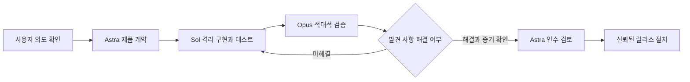

# ZeroPW 클라우드 개발 하네스

> 2026-09-12 사용자 교정 반영: Astra 기획·Sol 서브에이전트·Opus 검증과 클라우드 운영 방향은 유지한다. 아래에서 제품의 고정 어댑터·작업별 사전등록을 전제로 하는 부분은 더 이상 확정 요구가 아니다. 제품 UX 재설계 후 해당 부분과 검증 기준을 갱신한다.

작성일: 2026-09-11 · 목표 운영 구조 · 아직 프로비저닝하지 않음

## 1. 역할

| 역할 | 사용자 지정 모델 | 책임 |
| --- | --- | --- |
| PO와 설계 책임자 | Astra | 의도 정렬, 범위, 설계 판단, 제품 문서, 작업 분해, 일반 이견 조정과 보안 쟁점의 사용자 보고 |
| 구현 서브에이전트 | Sol | 좁은 조사, 코드 변경, 테스트와 검증 증거 작성 |
| 적대적 리뷰어 | Claude Opus | 보안 경계 공격, 요구 위반, 구현·테스트 누락 지적과 재검증 |

현재 Codex 실행 환경에서 확인한 선택 이름은 `gpt-6-astra`, `gpt-5.6-sol`이다. Claude CLI에는 `opus` 별칭이 있다. 이 이름들이 모든 클라우드 API와 계약에서 그대로 지원된다는 뜻은 아니다. 클라우드 연결 시 실제 provider·정확한 model ID·버전·응답 metadata를 기록하고, 요청 모델이 없으면 대체 모델로 조용히 진행하지 않는다.

Opus의 검증은 별도 역할이므로 Sol 서브에이전트 규칙의 예외다. 리뷰어는 설계나 코드를 작성하는 구현자와 분리한다. 리뷰 결과를 근거 없이 PO가 삭제하거나 `PASS`로 바꾸지 않는다.

Opus가 Critical/High로 분류한 발견 사항은 Astra가 일반 이견으로 낮춰 종결할 수 없다. 수정 증거와 Opus의 재검증 또는 사용자의 명시적 판단까지 미해결 상태를 유지하고, 사람에게는 원래의 지적과 변경 내용을 함께 제시한다. 구현자가 리뷰 원문·상태·gate 규칙을 수정할 수 없게 한다.

사용자가 위험을 수용한 경우에는 `risk_accepted`로 별도 기록하며 `resolved`로 바꾸지 않는다. 해결되지 않은 Critical/High의 자동 출시 차단은 유지한다. 위험 수용을 이유로 출시하려면 사용자가 별도의 구체적인 릴리스 판단을 해야 하며, 모델이 gate를 해제하지 않는다.

## 2. 작업 진행

기획 단계에서는 Astra의 문서에 먼저 Opus 검증을 받는다. 구현 단계에서는 변경별로 범위·인수 조건·금지사항·관련 문서·허용 파일·검증 명령을 Sol에 전달한다. Sol은 구현과 테스트 증거를 제출하고, Opus는 같은 변경 digest와 제품 계약을 읽어 반례를 찾는다. 문서 작성과 제품 결정은 Astra에 남긴다.

리뷰 결과에는 심각도, 위치, 재현 또는 공격 경로, 영향, 해결 조건을 요구한다. Critical/High 미해결은 출시를 막고 Medium은 해결하거나 사용자에게 구체적으로 남은 위험을 제시한다. 변경 후에는 해당 발견 사항과 수정으로 영향받은 경계를 재검증한다. 무한 수정 루프 대신 반복 한도를 두고 논쟁이 남으면 Astra가 원인과 선택지를 사용자에게 올린다.

## 3. 클라우드 배치

하네스 조정기는 지속 상태를 저장하고, 각 작업은 폐기 가능한 클라우드 작업 환경에서 실행한다. 작업 큐, 모델별 호출 어댑터, 제한된 소스 checkout, 테스트 실행기, artifact 저장소, 신뢰된 gate를 둔다. 변경 digest·실제 모델 ID·프롬프트 버전·검증 결과를 추적한다. 영구 root 권한이나 사람의 홈 디렉터리를 통째로 공유하지 않는다.

제품의 비밀 실행기와 제품을 개발하는 에이전트 실행기를 별도 신원·저장소·네트워크 권한으로 분리한다. 하네스의 OpenAI/Anthropic 접속 자격도 관리형 비밀 저장소 또는 workload identity로 모델 호출 계층에만 제공한다. 작업 프롬프트·agent 환경변수·이미지에 고객 비밀이나 provider 키를 넣지 않는다.

모델이 작성한 코드와 CI 설정은 신뢰하지 않는다. 구현·테스트 작업에는 가짜 비밀만 주고, 보호된 배포 작업만 최소 권한으로 배포할 수 있게 한다. agent가 수정한 workflow나 테스트 스크립트를 프로덕션 비밀이 있는 job에서 그대로 실행하지 않는다. 어댑터 등록·정책 확대·비밀 접근 신원 변경은 보호된 관리 절차를 거친다.

어댑터 digest 등록·변경, egress 대상 확대, 사용 정책 확대, 비밀 접근 신원과 gate 규칙 변경은 제품 소유자인 사람이 하네스 외부의 관리 세션에서 해당 변경 digest에 결합된 승인을 해야 한다. 모델에게 이 관리 신원이나 승인 서명 권한을 주지 않는다. Critical/High가 해결되지 않은 변경은 자동 출시하지 않으며 Astra가 미해결 쟁점으로 사용자에게 보고한다. 사전에 승인된 작업을 반복 실행할 때마다 새 승인을 요구한다는 뜻은 아니다.

반복 실행 예외는 동일 어댑터 digest·연결·비밀 버전·대상과 사전 허용 정책 범위 안의 실행에만 적용한다. 어댑터 등록 자체나 보안 정책 변경 승인을 작업 종류 전체에 대한 포괄 승인으로 재사용하지 않는다. digest·대상·egress·정책 범위가 바뀌면 새 승인이다.

인증 방식, 모델 가용성, 큐 중복 처리, 비용 한도, 실행 시간 제한, 공급자 장애 시 중단·재개를 클라우드 구축 전에 검증한다. 이번 턴은 문서와 설계 검증 단계이며 클라우드 계정·인프라를 생성하거나 제품을 배포하는 단계가 아니다.

## 4. 하네스 수용 기준

- 작업마다 역할과 실제 모델이 기록되고 요청과 다르면 실패한다.
- 문서·코드·검증 결과의 digest가 일치하며 구현자가 자신의 리뷰 gate를 승인할 수 없다.
- Opus의 자연어 `PASS`만으로 출시하지 않고 필수 검증과 미해결 발견 사항을 신뢰된 코드가 확인한다.
- 리뷰 대상 안의 지시문은 데이터로 다루며 reviewer 도구 권한을 확대하지 않는다.
- 모델·테스트 작업은 프로덕션 비밀, 배포 role, 정책 편집 권한에 접근할 수 없다.
- 중단·재시도·중복 요청에서 같은 외부 쓰기 동작을 반복하지 않고 상태를 복구한다.

## 5. 이번 문서 작성의 실제 실행

Astra가 제품 판단과 문서를 작성하고, `gpt-5.6-sol` 서브에이전트 두 개가 공식 기능 조사와 빈 작업 폴더 점검을 수행했다. Claude Opus 리뷰의 실제 결과와 실행 모델은 `reviews/`에 기록한다. 문서 산출물은 현재 로컬 작업 폴더에서 생성한다. 이것을 클라우드 하네스가 구축됐다는 증거로 취급하지 않는다.

Claude CLI 호출 동작 참고: https://code.claude.com/docs/en/cli-reference
