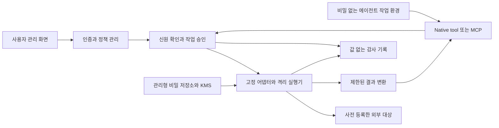

# ZeroPW 클라우드 보안 설계 초안

> 2026-09-12 상태 변경: 사용자가 작업별 사전등록 UX를 거부했다. 아래 고정 어댑터·등록된 작업에 의존하는 보안 계약은 이전 제안이며 새 UX에 그대로 적용할 수 없다. 명령 사용의 자유도와 비밀 보호 경계를 다시 설계해야 한다.

> 추가 확인된 목적: 에이전트가 제어하는 실행 프로세스에 원본 자격증명을 주는 일반 env injection도 핵심 해결책으로 삼지 않는다. 원본 키를 보유하는 신뢰된 인증 중계기·서명기와 비밀 없는 클라이언트를 분리하는 방식을 검토한다. 서비스·인증 방식 연결과 작업별 사전등록은 구분하며, 원본 키 비노출이 허용된 권한의 악용까지 방지한다는 뜻은 아니다.

작성일: 2026-09-11 · 설계 제안이며 구현 보증서가 아님

## 1. 보안 경계

보호 대상은 자격증명 원문과 그 사용 권한이다. 모델, 에이전트 런타임, 에이전트가 수정한 코드·의존성·설정은 비밀을 직접 읽는 신뢰 영역에 포함하지 않는다. 사용자 관리 세션, 비밀 처리 서비스, 승인된 어댑터, 격리 실행기, 키 관리 시스템, 인증 대상 서비스는 작업에 따라 신뢰해야 한다.

클라우드 KMS와 관리형 비밀 저장소를 우선 사용하고 자체 암호 알고리즘을 만들지 않는다. 저장 암호화, TLS, 최소 권한 IAM은 기초다. 실행 시 복호화되는 값은 처리 서비스의 메모리에 존재한다. KMS를 쓴다는 사실만으로 관리자·호스트 침해를 방어하거나 종단간 암호화·zero-knowledge가 되는 것은 아니다.

## 2. 구성



제품 저장소·broker·runner는 클라우드에서 운영한다. agent 런타임에는 저장소 읽기/KMS 복호화 권한을 주지 않는다. 비밀을 사용하는 작업은 별도 신원과 파일 시스템을 사용하고 agent 작업 디렉터리, 프로세스 공간, 디버그 인터페이스, 공유 볼륨을 통해 접근할 수 없게 한다. 네트워크의 모든 요청은 인증·권한 검사를 거친다.

하네스와 agent 신원은 비밀 저장소·KMS 정책 수정, 실행기 역할 위임·가정, 보호된 배포 신원 사용을 금지한다. 권한 경계와 저장소 정책에서 우회 경로까지 강제하며, 해당 경계의 변경은 사람이 보유한 별도 관리 신원에서만 수행한다. 별도 계정·프로젝트 분리는 우선 검토하되 구체적인 제공자 배치는 구현 설계에서 확정한다.

같은 금지는 저장한 자격증명을 통해 우회하는 경로에도 적용한다. ZeroPW의 인프라·KMS·비밀 저장소·감사·백업·DNS·복구·결제 관리 자격과 하네스 모델 계정의 관리·호출 자격은 workload 비밀로 저장하거나 연결하지 않는다. 운영용 bootstrap 자격은 별도 관리 체계에 둔다. 사용자 앱용 API 키는 관리할 수 있으나 ZeroPW의 신뢰 경계를 바꿀 권한이 없어야 한다. 이 자기참조 권한 검사는 자격증명 문자열에서 추정하지 않고 발급 권한·역할·대상 범위의 등록 및 검증으로 수행한다. 계정 분리 여부와 우회 방지 증거는 첫 클라우드 프로비저닝 전에 확정한다.

MVP는 단일 사용자·단일 리전을 제안한다. 제공자와 런타임은 미정이다. 선택 기준은 격리 강도, 작업별 신원, 목적지 제어, KMS/비밀 저장소, 암호화 백업, 운영 비용이다. 초기부터 Kubernetes나 자체 vault 암호화 계층을 도입할 필요는 없다.

## 3. 도구 계약

에이전트에게 `list_operations`, `execute_operation`, `get_execution`, `cancel_execution`만 제공한다. 권한은 서버에서 연결별로 필터링한다. `get_secret`, `reveal`, `export`, 임의 `exec`, 범용 HTTP 프록시는 제공하지 않는다. 연결 ID는 권한이 아니며 ID를 알더라도 호출자 권한 검사를 통과해야 한다.

개념 예시이며 구현된 API는 아니다.

```json
{
  "operation": "database.connection_check",
  "connection_id": "conn_dev_primary",
  "parameters": {},
  "request_id": "client-generated-id"
}
```

결과는 `execution_id`, `status`, 제한된 `result`, 표준 오류 코드만 반환한다. 원시 stdout/stderr, stack trace, 요청 헤더·본문, 접속 문자열, 인증값을 포함한 URL, 임의 파일은 반환하지 않는다. 결과 조회와 취소에도 실행 소유권을 검사한다.

에이전트의 접속 자격은 비밀 저장소 접근권이 아닌 작업 요청권이다. 클라우드 런타임의 workload identity를 우선하고, 불가능하면 범위·만료가 제한된 접속 자격을 agent의 모델 컨텍스트 바깥 주입 계층에서 관리한다. 탈취되어도 허용된 동작을 악용할 수 있으므로 사용 횟수·속도·대상과 즉시 회수를 강제한다.

모델 컨텍스트 바깥 주입은 대화 기록 유출을 줄이는 조치다. 에이전트 런타임은 자신의 작업 요청권을 사용할 수 있고, 배치에 따라 접속 토큰을 읽을 수도 있다는 전제를 유지한다. 실제 권한 경계는 서버 측 검사와 별도 실행 신원으로 강제한다.

## 4. CLI와 API 실행 규칙

- 정책 관리 영역에서 검토된 어댑터만 등록하고 버전·이미지 digest를 고정한다. agent가 생성한 코드나 변경한 실행 파일은 비밀을 가진 실행기에 바로 넣지 않는다.
- CLI는 절대 경로 실행 파일과 배열 형태의 검증된 인자를 사용한다. shell 문자열 보간을 하지 않는다. 실행 파일 allowlist만으로는 부족하며 서브커맨드·플래그·리소스·파라미터 의미까지 제한한다.
- 임의 스크립트, SQL, 템플릿, 플러그인, 사용자 config, startup 파일, PATH 확장, `LD_PRELOAD`, 프록시 환경변수 같은 간접 실행 경로도 막는다. 읽기 전용 작업에 필요한 최소 입력만 받는다.
- CLI 호환이 필요한 경우 해당 단일 자식 프로세스에 최소 환경변수를 주입한다. 실제 값은 그 프로세스에 존재한다. 프로세스는 비특권, 일회성, 제한된 네트워크와 파일 시스템에서 실행한다. core dump, 디버그 출력, 비밀을 담는 캐시를 끈다.
- API 어댑터는 신뢰된 서비스가 인증을 붙이고, 대상·메서드·경로·본문 스키마를 고정한다. agent의 URL이나 헤더를 그대로 전송하지 않는다.
- egress는 대상별로 제한한다. DNS 재바인딩·내부 주소·metadata endpoint·redirect·프록시 우회를 검증한다. 도메인 allowlist만으로 허용 사이트의 업로드·댓글 등에 유출하는 경로를 막을 수 없으므로 요청 내용과 외부 서비스 권한도 제한한다.
- 출력은 어댑터별 스키마와 허용 항목으로 생성한다. 임의 텍스트에 정규식 마스킹을 적용한 결과를 안전하다고 보지 않는다. 실패 시 상세 원문 대신 표준 코드로 닫는다. 마스킹은 추가 방어다.

v1의 결과 필드는 의미가 정해진 enum·불리언·범위가 제한된 정수·서버 생성 ID·타임스탬프로 제한하고, 외부 자유 텍스트는 반환하지 않는다. 형식만 맞는 필드도 자동으로 안전해지는 것은 아니므로 어댑터별 데이터 출처와 노출 항목을 검토한다. 반환 데이터는 신뢰되지 않는 데이터로 취급하며 추가 권한을 부여하는 지시로 해석하지 않는다. 허용된 결과는 모델 제공자에게 전송될 수 있다.

초기 검증 예시는 고정된 DB 연결 검사와 특정 저장소의 제한된 메타데이터 읽기다. GitHub 같은 서비스의 자유 텍스트나 DB 임의 질의를 그대로 돌려주는 어댑터는 별도 데이터 노출 정책이 필요하다. 임의 프로그램에 비밀을 넣는 호환 실행은 이 보안 계약 밖이며 초기에는 제공하지 않는다.

## 5. 승인과 권한 수명

사용자는 저위험 읽기 작업을 환경·대상·만료·횟수 범위로 사전 허용할 수 있다. 새로운 대상, 비밀 연결 변경, prod 사용, 쓰기·삭제·배포·결제는 별도 정책과 구체적인 승인 요청이 필요하다. 에이전트는 정책을 승인하거나 확장할 수 없다.

사전 허용 기본값은 0이다. 어댑터 manifest는 반환 필드별 민감도를 지정하고, 낮은 민감도의 정해진 결과만 자동 허용 대상으로 제안한다. 사용자 관리 화면에서 반환 데이터와 대상까지 보고 켜야 한다. 민감한 업무 데이터의 자동 제공은 별도 정책 없이는 거부한다.

사전 허용도 호출자·프로젝트·환경·대상·작업·어댑터 digest·연결·비밀 버전·파라미터 허용 범위·만료·횟수에 결합한다. 코드 digest, 연결, 비밀 버전 또는 정책 범위가 바뀌면 무효화하고 사용자가 다시 설정한다. 각 실행에서는 실제 입력을 정책 범위와 비교한 뒤 해당 입력 digest에 결합된 일회 실행 권한을 만든다.

승인 화면은 검토된 어댑터 manifest와 서버가 정규화한 환경·대상·변경 내용을 바탕으로 생성한다. agent가 제공한 설명·작업명·승인 사유를 믿을 수 있는 승인 문구로 표시하지 않는다. 신규 대상과 권한 확대를 명확히 구분하고, 대기 요청 수 제한·중복 억제·거부 후 쿨다운으로 승인 폭주를 막는다.

승인은 호출자, 프로젝트, 환경, 연결·비밀 버전, 작업·어댑터 digest, 정규화된 입력 hash, 대상, 만료, 횟수에 결합한다. 승인을 받기 전·후에 코드나 입력이 바뀌면 새 요청으로 처리한다. 서버가 실행 직전에 정책과 회수 상태를 다시 확인하고 nonce를 원자적으로 소모한다.

큐 재시도는 같은 권한을 무한 재사용하지 못한다. idempotency key와 실행 기록을 사용하며, 외부 쓰기 요청의 결과가 불명확하면 자동 재전송하지 않고 `unknown` 상태로 조정한다. 회수 후 새 실행은 차단하고 대기 작업을 취소하며 실행 중 작업에는 취소를 시도한다. 외부 서비스에서 끝난 동작과 이미 읽힌 메모리는 되돌릴 수 없다.

클라이언트 `request_id`는 호출자별로 구분하고, 최초 접수 때 작업·대상·정규화된 전체 입력의 digest에 변경 불가능하게 결합한다. 동일 호출자의 같은 ID에 다른 입력이 오면 거부한다. 재시도는 기존 실행 상태를 조회하며 다른 입력에 이전 승인이나 결과를 재사용하지 않는다.

사용자에게 전체 실행 정지 스위치를 제공한다. 활성화되면 모든 신규 실행을 거부하고 대기 작업을 취소하며 진행 중 작업에는 취소를 시도한다. 사전 허용 한도 소진과 비정상 호출 패턴을 값 없는 알림으로 전달한다. 취소는 완료된 외부 동작을 되돌리지 않는다.

## 6. 비밀 수명과 복구

사용자 로그인은 패스키 또는 MFA를 지원하고 비밀 변경·권한 확대·복구에는 재인증한다. 관리 화면은 agent가 자동화하는 브라우저와 분리하며 세션 탈취·CSRF·XSS 방어가 필요하다. 관리 화면, API gateway, APM, 오류 추적에서 입력값·request body 캡처를 끈다.

사람의 비밀 읽기·쓰기 API는 별도 관리용 인증을 요구하고 agent·하네스 신원에는 명시적으로 거부한다. 네트워크 경계도 분리하되 CORS나 요청 origin만으로 사람을 인증하지 않는다. 사용자에게 대화창으로 값을 붙여넣게 하지 않는다. 사람이 값을 확인할 때도 단건 재인증·속도 제한·감사를 적용하고 일괄 export를 제공하지 않는다.

로그인 복구는 오프라인 복구 코드와 사전에 등록한 독립 인증 요소를 함께 요구하는 방향으로 설계한다. 이메일 단독 복구를 제공하지 않는다. 복구 완료 시 기존 agent 세션과 연결 사용권을 중지하고 사용자가 검토해 다시 활성화한다. 두 복구 수단을 모두 잃었을 때 자동 접근 복구를 보장하지 않는다. KMS의 운영 복구와 사용자 로그인 복구는 별도 절차다.

초기 키 교체는 사용자가 외부 발급처에서 새 키를 만든 후 ZeroPW에 새 버전을 등록하고 연결 검사와 전환을 수행하는 수동 흐름이다. 저장소에서 값을 바꾸는 것과 외부 제공자에서 이전 키를 폐기하는 것을 구분한다. 자동 rotation은 제공자별 통합 이후에 추가한다.

암호화 백업, 보관기간, 키 삭제 유예, 사용자 로그인 복구, KMS 접근 복구를 각각 정의한다. 백업 파일만으로 KMS 키나 인증 수단을 복구할 수는 없다. 복구 시험에서 비밀 버전과 접근 정책의 일관성을 확인하고, 회수 이력을 재적용하기 전까지 복원 환경은 모든 실행을 거부한다. 개발 에이전트의 권한으로 복구 정책을 바꿀 수 없게 한다.

감사 기록은 호출자 ID, 작업 ID, 대상 ID, 비밀 버전 식별자, 승인·거부 이유 코드, 시간, 결과 상태를 남긴다. 입력 원문, 임의 이름/설명, 인증정보는 기록하지 않는다. agent와 runner는 기록 삭제 권한이 없다. 감사·승인 시스템 장애 시 신규 비밀 사용을 거부하는 것은 인수 기준이다.

백업과 감사 저장소는 일반 실행 권한과 분리하고 agent·runner·broker의 읽기·변경·삭제를 거부한다. 전용 백업·복구 신원만 필요한 접근을 가지며, 감사 생산자는 추가 쓰기만 가능하다. 잠금 또는 동등한 불변 보관 기능으로 기존 감사 기록 변경을 막고, 사용자 열람은 별도 관리 서비스에서 수행한다.

## 7. 출시 전 공격 시나리오

| 공격 | 필요한 결과 |
| --- | --- |
| prompt injection으로 `printenv`·Python 요청 | 등록되지 않은 작업과 코드 실행 거부 |
| CLI 플래그·config·패키지 hook으로 우회 | 고정 어댑터와 환경에서 우회 불가 |
| 다른 환경의 연결 ID·실행 ID 대입 | 목록·실행·조회·취소 전부 소유권 거부 |
| 승인 후 대상·인자·이미지·비밀 버전 변경 | 승인 결합 불일치로 거부 |
| 토큰 재사용·동시 실행·큐 재시도 | nonce·호출량·만료·회수 검사로 범위 유지 |
| 값 출력·base64·분할·오류 반사 | 원시 출력 및 알 수 없는 필드 반환 금지 |
| 외부 업로드·redirect·DNS·metadata 우회 | 네트워크와 요청 의미 검사로 차단 |
| 파일·덤프·캐시·공유 볼륨 열람 | 비밀 실행 환경에서 agent 접근 불가 |
| 백업 복원으로 과거 권한 재활성화 | 회수 상태 반영 전 실행 거부 |
| 모델 출력이 리뷰 통과 또는 정책 변경 명령을 위조 | 구조화된 결과와 신뢰된 gate만 판단에 사용 |
| 외부 응답에 후속 작업 지시 삽입 | 자유 텍스트 반환 차단, 결과로 정책 확대 불가 |
| 승인 화면의 설명 위조·요청 폭주 | 서버 생성 승인 내용, 중복 억제·상한 적용 |
| 같은 request ID에 다른 명령 제출 | 입력 digest 불일치 거부 |
| 이메일 탈취로 계정 복구 시도 | 독립 복구 요소 필요, 기존 사용권 재활성화 금지 |
| 관리 API·백업·KMS·role 위임 우회 | agent 신원의 직접·간접 접근 거부 |
| 통제면 관리 자격을 작업용 비밀로 등록 | 권한·대상 검증으로 등록·연결 거부 |
| 어댑터나 키 버전 변경 후 옛 사전 허용 사용 | 기존 사전 허용 무효화 |
| 여러 연결에서 반복 호출하며 한도 소진 | 전체 정지와 사용량 알림 동작 |

가짜 비밀로 이 경로들을 검증하고, 후속 모델 요청과 저장된 추적까지 조사한다. 적대적 모델 리뷰는 설계 결함을 찾는 보조 수단이며 침투 테스트나 안전 인증을 대체하지 않는다. 이 문서 시점에는 보안 기능이 구현되거나 검증된 상태가 아니다.
