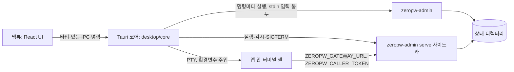

# ZeroPW 데스크톱 앱

작성일: 2026-10-15 · 구현 명세 · 이슈 [#19](https://github.com/telicity-ai/zeropw/issues/19)

이 문서는 ZeroPW 관리 기능을 Rust + Tauri v2 데스크톱 앱으로 제공하는 방법을 정한다. 화면과 움직임의 규칙은 [DESIGN.md](../DESIGN.md)에, 승인된 온보딩 목업은 [desktop/mockup/onboarding.html](../desktop/mockup/onboarding.html)에 있다. [제품 정의](product-intent.md)와 [보안 경계](security-design.md)의 요구사항은 바꾸지 않는다.

## 1. 범위

- 관리자가 쓰는 기능 전부를 화면으로 옮긴다: 보관함 만들기, 프로젝트·환경, 키(환경변수 포함), 서비스 연결, 에이전트와 권한, 사용 기록·알림, 전체 정지·재개, 사고 처리, 백업·복원·복구, 팀 공유.
- 팀 초대는 24시간 동안 한 번만 쓸 수 있는 링크(`zeropw://join#…`)로 주고받는다. 링크를 열면 미리보기만 띄우고 자동으로 합류하지 않는다.
- 에이전트 설정처럼 셸에서 하던 일은 앱 안 터미널에서 미리 채운 명령을 엔터로 실행해 끝낸다.
- 첫 실행 온보딩에는 서비스 연결을 넣지 않는다. 연결은 대시보드에서 만든다(2026-10-15 사용자 결정).
- macOS용으로는 Apple Silicon(arm64) .dmg를 ad-hoc 서명한 미리 보기로 만든다. 소유자는 2026-10-16에 이 이미지를 Developer ID 서명과 공증 없이 v0.2.0 제품 릴리스에 싣기로 정했다. 이 앱을 처음 싣는 릴리스가 v0.2.0이고, v0.1.0에는 앱이 없다. 공증하지 않은 빌드라 내려받아 처음 열 때 Gatekeeper가 막고, 사용자가 시스템 설정에서 직접 허용해야 열린다(§9, §10). v0.2.0 이미지는 macOS 26.5인 Mac 한 대에서 빌드하고 그 Mac에서 격리 속성 없이 실행해 봤을 뿐이고, 내려받은 이미지를 Gatekeeper를 거쳐 여는 과정은 어느 Mac에서도 시험하지 않았다. 소유자는 같은 날 깨끗한 Mac에서 설치하고 처음 여는 확인과 다른 확인 몇 가지를 이 미리 보기에 한해 면제했다(§9).
- 화면 문구는 한국어로만 쓴다. 관리 문서와 제품 출력은 영어가 기본이라는 릴리스 규칙([releasing.md](releasing.md)의 Gates 2번)의 예외로, 소유자가 2026-10-15 디자인 검토에서 화면 문구를 쉬운 한국어로 쓰라고 지시했다. 앱이 macOS 로컬 네트워크 권한 창에 넣는 설명(`Info.release.plist`)도 한국어다. 그 창의 제목과 버튼은 macOS가 정한다. 이 명세와 [DESIGN.md](../DESIGN.md)도 한국어로만 있다.

하지 않는 것: 원본 비밀을 에이전트에게 주는 호환 경로, 일괄 평문 내보내기, 모든 CLI 호환 약속, Developer ID 앱 서명·공증·자동 업데이트, Intel Mac용 빌드, 같은 macOS 계정의 에이전트로부터 보관함을 격리하는 일(§8.9).

## 2. 구조

- **관리 명령은 명령마다 `zeropw-admin` 자식 프로세스로 실행한다.** 비밀번호와 키 값은 argv나 환경변수가 아니라 stdin의 입력 봉투(§3.1)로 넘긴다. 앱 프로세스는 KMS 키를 메모리에 올리지 않는다. CLI에만 있는 검사(감사 기록, CLI 환경변수 검사, 공유 환경 분기, 재인증)를 그대로 거치므로 CLI와 앱의 동작이 갈라지지 않는다.
- **`serve`는 따로 띄우는 사이드카다.** 고정 포트(기본 `127.0.0.1:47380`), `--quiet`, 표준 오류는 앱 데이터 폴더의 0600 로그 파일로 보낸다. 창을 닫아도 계속 돌고, 앱을 끝낼 때 SIGTERM을 보낸다.
- **웹뷰는 원본 비밀을 받지 않는다.** 입력은 웹뷰에서 Rust로만 간다. 예외는 사용자가 패스워드를 다시 넣고 요청한 단일 비밀 조회, 새 에이전트의 호출 토큰, 초대 링크, 처음 한 번 보여 주는 복구 코드다. 앞의 셋은 일회용 보관소(§4.3)의 참조로만 돌려주고 `onetime_show`나 `onetime_copy`로 한 번만 나간다. 복구 코드는 `recovery_generate` 응답의 `groups`로 한 번 나가고, 보관소에 남은 값은 `vault_init`만 읽는다(`onetime_show`·`onetime_copy`로 다시 꺼낼 수 없다).
- 데스크톱 코드는 `zeropw` 크레이트를 링크하지 않는다. 같은 디렉터리에 함께 배포한 `zeropw-admin`, `zeropw_session`, `zeropw-agent` 바이너리만 실행한다.

## 3. 제품 쪽 변경 (`rust/`)

### 3.1 입력 봉투 `--input-envelope`

`zeropw-admin --state-dir DIR --input-envelope COMMAND …` 형태의 전역 옵션을 더한다.

- 시작할 때 stdin을 한 번 읽는다(최대 256 KiB). 내용은 JSON 객체이며 다음 문자열 필드만 허용한다. 모르는 필드, 문자열이 아닌 값, 크기 초과는 `UsageError`/`envelope_invalid`로 거부하고 값을 출력하지 않는다.
  - `admin_passphrase`
  - `recovery_passphrase`
  - `value_b64`: `secret put --stdin`, `rotation start --stdin`에 쓸 값(표준 base64)
  - `invite`: `team join --stdin`, `team invite-info --stdin`에 쓸 초대 문자열이나 링크
- 봉투가 있으면 `passphrase()`는 봉투에서만 읽는다. 해당 필드가 없으면 환경변수나 터미널로 넘어가지 않고 `passphrase_missing`으로 실패한다.
- 봉투가 있을 때 `--stdin`은 stdin을 다시 읽지 않고 `value_b64`를 쓴다. 없으면 `secret_source_required`다.
- 봉투에서 읽은 값은 `Zeroizing`으로 들고 다니며 명령이 끝나면 지운다.
- 봉투가 없으면 지금과 똑같이 동작한다. 기존 출력 JSON은 바뀌지 않는다.

CLI는 재인증을 받지 않지만 앱은 받아야 하는 명령(`resume`, `connection create-http`·`create-ssh`·`update --cli-program`, `grant create`, `approvals approve`, `team invite`, `team remove`, `restore`)에는 숨은 전역 옵션 `--require-admin`을 함께 넘긴다. 이 옵션은 `--input-envelope`와 같이 쓸 때만 받고, 봉투 없이 쓰면 `UsageError`다. 명령을 실행하기 전에 봉투의 `admin_passphrase`를 CLI가 재인증할 때 쓰는 경로(`verify_admin`) 그대로 확인한다. 비밀번호가 틀리거나 없으면 `auth_failed` 감사 기록(`state`는 `require_admin`)을 남기고 그 오류(`admin_reauth_failed`, `passphrase_missing`)로 멈추며, 상태는 바뀌지 않는다. 감사 기록을 쓸 수 없는 상태 디렉터리에서는 확인하기 전에 거부한다. 확인을 통과하면 명령은 옵션이 없을 때와 똑같이 돌고, `incident close`처럼 원래 재인증하는 명령은 비밀번호를 한 번 더 확인한다. `--input-envelope`처럼 도움말과 사용법에는 나오지 않는다. `rust/tests/admin_input_envelope.rs`가 틀리거나 빠진 비밀번호, 맞는 비밀번호, 봉투 없이 쓴 경우, 이미 재인증하는 명령을 시험한다.

같이 읽기 전용 명령 `zeropw-admin status`를 더한다. 출력은 `stop-all`·`resume`과 같은 `{stopped, restore_pending, incident_open}`이다. 앱이 정지 상태를 바꾸지 않고 읽을 때 쓴다.

시험(`rust/tests/admin_input_envelope.rs`): 봉투의 비밀번호로 `init`·`secret reveal`·`incident close`가 되는지, 봉투가 있을 때 `ZEROPW_ADMIN_PASSPHRASE`를 무시하는지, 필드가 없으면 `passphrase_missing`인지, 잘못된 봉투가 값을 되풀이하지 않고 거부되는지, `secret put --stdin`이 `value_b64`를 쓰는지, 오류 출력과 감사 기록에 봉투 값이 없는지.

### 3.2 하루짜리 초대 링크

기존 초대 문자열(`team invite`가 출력하는 base32 문자열, 와이어 형식)은 바꾸지 않고 링크로 감싼다.

- 링크 형식: `zeropw://join#<초대 문자열>`. `zeropw://join/#…`도 받는다. 스킴·호스트는 대소문자를 가리지 않고, 질의 문자열·사용자 정보·포트·추가 경로·퍼센트 인코딩·공백·두 번째 `#`가 있으면 거부한다. 최대 4096바이트.
- `team invite --env P/E --role R --name N --address H:P [--link]`: `--link`를 주면 유효 기간을 24시간으로 고정하고(`--ttl`이 24시간이 아니면 `invite_link_ttl_fixed`), 출력에 `link`, `invite_id`(초대 비밀 SHA-256 앞 16바이트의 16진수), `expires_at`을 더한다. `--link`가 없으면 출력은 지금과 같다.
- `team invites --env P/E`: 이 기기가 만든 초대 목록. `{env_id, invites:[{invite_id, role, name, link, created_at, expires_at, status, used_at, used_by, revoked_at}]}`. `status`는 `pending|used|expired|revoked`. 비밀·암호문은 나오지 않는다.
- `team revoke-invite --env P/E --id ID`: 아직 쓰이지 않은 초대만 막는다. 다시 불러도 성공한다. 없는 ID는 `invite_not_found`, 이미 쓰인 초대는 `invite_already_used`. 감사 기록 `team_invite_revoke`.
- `team invite-info --stdin`: 봉투의 `invite`(또는 봉투 없이 stdin)를 읽어 네트워크 없이 미리보기를 낸다. `{env_id, inviter, addresses, role, name, expires_at, expired, invite_id}`.
- `team join --stdin [--project P --environment E]`: 초대를 argv 대신 봉투나 stdin으로 받는다. 위치 인자도 계속 받는다. 링크 형식도 받는다. 연결하기 전에 만료 여부를 로컬에서 먼저 확인한다(시계 차이 300초 허용, `invite_expired`).
- 상태 파일 `team/<env-id>/invites.json` 항목에 선택 필드 `created_at`, `revoked_at`, `used_at`, `used_by`를 더한다. 예전 항목도 그대로 읽는다. 쓰였거나 취소된 항목은 `wrapped_secret`을 지운다.
- 미리보기·참여 쪽에서 파싱한 초대도 주소는 16개, 각 128바이트까지만, `HOST:PORT` 모양만 받는다. `inviter`는 26자 지문 형식이어야 한다.

시험(`rust/tests/team_invite_link.rs` 등): 링크와 초대 문자열 왕복, 잘못된 링크 거부(입력 비반사), 1회 사용, 정확히 24시간 만료, 취소한 초대 거부, 취소와 사용 경합에서 한쪽만 성공, 목록에 비밀 없음, 예전 항목 호환, CLI 출력 키.

## 4. 데스크톱 코어 (`desktop/core`)

Tauri에 의존하지 않는 Rust 라이브러리다. 모든 로직과 시험은 여기 둔다.

### 4.1 AdminRunner

- `run(args, envelope) -> Result<Value, AppError>`: `zeropw-admin --state-dir <dir> --input-envelope <args…>`를 실행한다. 환경은 비우고 `PATH=/usr/bin:/bin`, `HOME`, `LANG=C.UTF-8`, `TMPDIR`만 준다. 봉투 JSON을 stdin에 쓰고 닫는다. 기본 제한 시간 60초, `team join`은 90초.
- 성공하면 stdout JSON을, 실패하면 stderr의 `{error, reason, detail}`을 `AppError`로 돌려준다. 다른 출력은 버린다.
- 인자는 타입 있는 입력에서만 만든다. 값은 `--flag=value` 형태로 넣어 옵션으로 오인되지 않게 하고, 위치 인자는 미리 형식을 검사한다. 비밀 값은 argv에 넣지 않는다.
- 바이너리 위치: 앱 실행 파일과 같은 폴더(번들), 개발 중에는 `ZEROPW_BIN_DIR`.

### 4.2 ServeSupervisor

- 시작: `zeropw-admin --state-dir D serve --listen 127.0.0.1:<port> [--team-listen IP:PORT] --quiet`, 환경은 4.1과 같다. 첫 stdout 줄의 JSON에서 `url`을 읽고 `/healthz`가 200을 줄 때까지 기다린다(60초).
- 단일 인스턴스: 앱 데이터 폴더의 `serve.json`(pid, url, 시작 시각). 다시 켤 때는 pid가 살아 있고 `/healthz`와 `Server: zeropw-prototype` 헤더가 맞을 때만 이어 붙는다.
- 중지: SIGTERM, 최대 25초 기다린 뒤에만 SIGKILL.
- 감시: 코어는 2초마다 사이드카가 아직 있는지 본다. 앱이 띄운 사이드카는 자식 프로세스가 끝났는지로, 이어 붙은 사이드카는 pid에 신호(`kill(pid, 0)`)를 보내 안다. 시작이나 중지가 진행 중이면 그 차례는 건너뛴다. 사이드카가 스스로 끝났거나 누가 끝냈으면 창이 묻기 전에 `serve://status`로 꺼졌다고 알린다. 창에 마지막으로 알린 상태와 다를 때만 보낸다. 끝난 사이드카를 다시 켜지는 않는다.
  - 이어 붙은 사이드카의 부모였던 예전 앱은 이미 끝났으므로, 사이드카가 끝나면 launchd나 init이 바로 거둬 가고 다음 감시에서 신호가 실패한다. 신호에 답하는 좀비는 `ps`로만 가릴 수 있지만, `ps`를 2초마다 띄우지 않도록 감시는 15번에 한 번(30초)만 `ps`도 본다. `serve_status`, 이어 붙기, 시작, 중지는 매번 `ps`를 보고, 중지는 신호를 보내기 전에 명령줄까지 확인하므로 다시 쓰인 pid에는 신호를 보내지 않는다.
  - 시작, 중지, 앱을 켤 때의 이어 붙기도 감시와 같은 잠금 안에서 결과를 창에 알린다. 그래서 그사이에 감시가 끼어들지 못하고, 창이 받는 상태의 순서는 실제로 일어난 순서와 같다.
- 시작하다 사이드카가 끝나면 로그에 남은 CLI 오류를 돌려준다. 주소를 열지 못한 실패는 어느 설정(`gateway_port`, `team_listen`) 때문인지 알린다(§5).

### 4.3 일회용 보관소 (OneTimeStore)

복구 코드, 호출 토큰, 초대 링크, 다시 본 비밀 값, 붙여 넣거나 링크로 받은 초대, 가져오려고 읽은 `.env` 파일을 `Zeroizing` 버퍼로 잠깐 들고 있는다. 무작위 128비트 참조로 꺼내며, 한 번 보여 주면 지운다. 수명은 비밀 값 60초, 붙여 넣거나 링크로 받은 초대 60분, 나머지 10분. 받은 초대만 길게 두는 것은 초대받은 사람이 링크를 확인한 뒤 보관함을 만들고(§7의 2~4단계) 합류하기 때문이다. `Debug`·`Serialize`를 구현하지 않는다.

- 항목마다 종류가 있어서 다른 용도로 꺼낼 수 없다. 웹뷰로 나갈 수 있는(`onetime_show`·`onetime_copy`) 것은 호출 토큰, 초대 링크, 다시 본 값뿐이다. 복구 코드는 `vault_init`만, 받은 초대는 `team_join`만, `.env` 파일은 `secret_import_preview`·`secret_import`만 읽는다.
- 앱이 만든 값은 예약까지 합쳐 256개까지 든다. CLI 호출이 상태를 바꾸고 값을 한 번만 출력하는 명령(`principal_create`의 토큰, `team_invite_create`의 링크, 감사 기록을 남기는 `secret_reveal`)은 CLI를 실행하기 전에 자리를 예약한다. 보관소가 가득 차면 아무것도 바꾸기 전에 `onetime_store_full`로 거절하고, 만든 뒤에 값을 잃는 일은 없다.
- `.env` 파일은 10분 동안 따로 4개까지 들고, 넘치면 가장 오래된 것부터 버린다. 가져오기가 성공하거나 시트를 닫으면 지운다([env-import.md](env-import.md) §8).
- 붙여 넣거나 딥 링크로 받은 초대는 따로 16개까지 들고, 넘치면 가장 오래된 것부터 버린다. 앱 밖에서 링크를 아무리 열어도 앱이 만든 값의 자리를 차지하지 못한다. `team_join`이 성공하면 그 초대는 바로 지운다. 실패하면 다시 시도할 수 있게 60분이 지날 때까지 둔다.

### 4.4 앱 안 터미널

- `portable-pty`로 사용자의 로그인 셸을 띄운다. 환경에 `ZEROPW_GATEWAY_URL`, `ZEROPW_CALLER_TOKEN`, `no_proxy=127.0.0.1,localhost`를 넣고, `PATH` 앞에 번들 바이너리 폴더를 둔다. 토큰은 키 입력으로 넣지 않으므로 화면과 셸 기록에 남지 않는다.
- 다른 macOS 계정에서 실행할 때 첫 제안 명령은 `sudo --preserve-env=ZEROPW_GATEWAY_URL,ZEROPW_CALLER_TOKEN,no_proxy -u <계정> -i`다.
- 제안 명령은 프롬프트에 입력만 해 두고 사용자가 엔터를 누르면 실행된다. 두 번째 제안은 `<번들 경로>/zeropw-agent list-connections`.
- 출력은 Tauri 채널로 웹뷰의 xterm.js에 보낸다.
- 키 입력(`terminal_write`)은 터미널마다 있는 쓰기 스레드의 큐에 넣고 바로 돌아온다. 실행 중인 프로그램이 입력을 읽지 않으면 PTY 쓰기가 끝나지 않을 수 있으므로, 쓰기는 터미널 목록의 잠금 밖에서 그 스레드만 한다. 읽히지 않은 입력이 256 KiB를 넘으면 기다리지 않고 `terminal_busy`로 거절한다. 목록, 다시 붙기, 크기 바꾸기, 닫기, 앱 종료는 막히지 않는다.
- 읽기·쓰기 스레드는 PTY를 비차단 모드로 쓰고, PTY와 그 터미널의 멈춤 파이프를 함께 기다린다(Linux는 `poll`, macOS는 `select`). 커널 안에서 멈춘 쓰기는 프로그램이 끝나도 깨어나지 않을 수 있기 때문이다. 그래서 붙여 넣기가 막힌 채로 터미널을 닫아도 두 스레드가 끝나고, 아직 쓰지 못한 입력은 지우고 버린다.
- 토큰은 셸과 셸에서 시작한 모든 프로세스의 환경에 있다. 그래서 터미널을 닫거나(`terminal_close`) 앱을 끝내면 셸만이 아니라 그 터미널에서 시작한 프로세스를 모두 멈춘다. 셸의 프로세스 그룹, 셸 자손의 그룹, 이 PTY를 제어 터미널로 쓰는 프로세스의 그룹(부모가 먼저 끝난 프로세스도 포함)에 SIGHUP과 SIGCONT를 보내고, 2초 뒤에도 남은 것은 SIGKILL로 끝낸다. 그 터미널의 읽기·쓰기 스레드가 끝나기를 기다려(최대 2초) PTY와 파이프를 모두 닫은 다음에 돌아온다. 앱 종료는 모든 터미널에 같은 과정을 한 번에 거친다.
- 닫아도 멈추지 않는 것:
  - 터미널의 세션과 프로세스 트리를 떠난 프로세스. `setsid <명령> &` 한 줄이면 떠난다(SIGHUP을 무시하지 않아도 된다). tmux·screen 서버와 데몬도 같다. 앱은 이들을 찾지 못한다.
  - 다른 계정으로 도는 프로세스. 온보딩이 추천하는 다른 계정 실행(`sudo --preserve-env=… -u <계정> -i`, §7 6단계)의 에이전트가 여기에 든다. 앱은 다른 계정의 프로세스에 신호를 보낼 수 없고(EPERM), 그런 그룹은 기다리지도 않는다. 이들은 셸이나 PTY가 끝날 때 커널이나 sudo가 보내는 SIGHUP만 받으며, SIGHUP을 무시하면 계속 돈다.
  - 이런 프로세스는 호출 토큰을 환경에 든 채로 계속 돌 수 있다. 닫은 터미널은 `terminal_list`에서 빠지므로 앱 화면에는 흔적이 남지 않는다. 남은 토큰을 막는 방법은 그 에이전트를 끄는 것(`principal_disable`)뿐이다.
- 터미널은 화면을 떠나도 닫지 않는다. 에이전트가 계속 돌아야 하기 때문이다. 출력은 터미널마다 256 KiB 링 버퍼에 남고, 에이전트 화면이 `terminal_list`로 목록을 받아 `terminal_attach`로 다시 붙으면 버퍼를 먼저 재생한 뒤 이어서 보낸다. 채널은 출력만 나르므로 셸이 끝났는지는 `terminal_list`의 `alive`로 안다.

### 4.5 설정과 경로

- 상태 디렉터리: 앱 데이터 폴더의 `state/` (macOS `~/Library/Application Support/ZeroPW/state`).
- 앱 설정 `settings.json`(0600): 중계기 포트, 팀 동기화 주소. 상태 디렉터리 안에는 쓰지 않는다.
- 파일 선택(키 파일, CA, 백업, `.env`)은 Rust에서 네이티브 창을 열고 경로를 불투명한 `file_token`으로만 웹뷰에 알린다.
- 창에 끌어다 놓은 파일도 경로는 Rust에만 있다. 셸이 놓인 경로를 코어에 넘기면 코어가 일반 파일 하나만 읽어 일회용 보관소에 두고, 웹뷰에는 `envfile://dropped`로 참조와 파일 이름만 알린다(§5, §8.10).

## 5. IPC 명령

모든 명령은 실패하면 `AppError {error, reason, detail?}`를 돌려준다. 입력값은 어떤 오류에도 되풀이하지 않는다. "재인증"은 관리 비밀번호를 함께 받아 봉투로 넘긴다는 뜻이다. CLI가 스스로 재인증하지 않는 명령에는 `--require-admin`을 붙인다(§3.1). 비밀번호가 비어 있으면 코어가 CLI를 부르기 전에 거절한다.

| 명령 | 입력 | 출력 | CLI | 재인증 |
| --- | --- | --- | --- | --- |
| `app_status` | | `{initialized, state_dir, serve, control}` | 상태 디렉터리 확인, `status` | |
| `password_strength` | `{value}` | `{score, reason}` | 코어의 zxcvbn. 입력이 바뀔 때마다 값이 IPC로 온다(§7) | |
| `recovery_generate` | | `{ref, groups[6]}` | 코어 CSPRNG, 값은 보관소 | |
| `vault_init` | `{admin_passphrase, recovery: {ref}\|{typed}}` | `{state_dir, kms_key_id}` | `init` 후 `serve` 시작 | 두 비밀번호 |
| `serve_start` / `serve_stop` / `serve_status` | | `ServeStatus`. 시작 실패 이유는 표 아래 | §4.2 | |
| `control_get` / `stop_all` / `resume` | | `{stopped, restore_pending, incident_open}` | `status`, `stop-all`, `resume` | `resume`은 재인증 |
| `project_list` / `project_create` | `{name, environments[]}` | 프로젝트. `project_list`는 팀 환경이 있으면 `team_environments`(`{project, environment, env_id}`)도 준다 | `project …` | |
| `secret_list` / `secret_versions` | `{project?, environment?}` / `{id}` | 값 없는 목록 | `secret list/versions` | |
| `secret_put` | `{id, kind, project, environment, source}` | 버전 정보 | `secret put --stdin` | |
| `secret_reveal` | `{id, version?, admin_passphrase}` | `{ref, id, version}` | `secret reveal` | 매번 |
| `secret_retire` / `secret_revoke` | `{id, version}` | CLI 출력 | `secret retire/revoke` | |
| `connection_list` / `connection_create_http` / `connection_create_ssh` / `connection_disable` | 연결 필드 | CLI 출력 | `connection …` | 만들기 재인증 |
| `connection_set_cli_program` | `{id, cli_program, admin_passphrase}` | CLI 출력 | `connection update --cli-program` | 재인증 |
| `principal_list` / `principal_create` / `principal_disable` | `{id, runtime}` | 생성 시 `{id, runtime, token_ref}` | `principal …` | |
| `grant_list` / `grant_create` / `grant_revoke` | `{principal, connection, ttl, max_uses?}` | 권한 정보 | `grant …` | 만들기 재인증 |
| `terminal_open` / `terminal_write` / `terminal_resize` / `terminal_close` | `{token_ref, as_user?}` 등 | `{terminal_id, suggestions[]}`, 출력은 채널. `terminal_write`는 `terminal_busy`일 수 있고 `terminal_close`는 그 터미널의 프로세스를 멈춘 뒤 돌아온다 | §4.4 | |
| `terminal_list` / `terminal_attach` | 없음 / `{terminal_id}`와 출력 채널 | `{terminals[{terminal_id, principal, as_user, alive}]}` / `{terminal_id, suggestions[]}`, 버퍼를 채널로 재생한 뒤 이어서 보낸다 | §4.4 | |
| `secure_view` | `{on}` | `{protected}`: 창 내용 보호 요청이 오류 없이 적용됐는지. 캡처 도구가 그 요청을 따르는지는 알려 주지 않는다. Linux에서는 늘 `false` | 창 내용 보호 요청(§8.8) | |
| `audit_tail` / `alerts` | `{limit}` | 값 없는 기록 | `audit tail`, `alerts` | |
| `approvals_list` / `approvals_approve` | `{digest}` | 승인 정보 | `approvals …` | 승인 재인증 |
| `incident_list` / `incident_show` / `incident_declare` / `incident_close` | 사건 필드 | 사건 정보 | `incident …` | `all` 범위·종료 |
| `backup_create` / `backup_restore` / `restore_ack` / `recover` | 파일은 Rust 창. `backup_restore`·`restore_ack`는 `{admin_passphrase}`, `recover`는 `{recovery_passphrase}` | CLI 출력 | `backup`, `restore`, `restore-ack`, `recover` | `backup_restore`(`--require-admin`), `restore_ack` 재인증, `recover`는 복구 코드 |
| `team_init` / `team_share` / `team_members` / `team_remove` | | CLI 출력 | `team …` | `share`·`remove` 재인증 |
| `team_invite_create` | `{env, role, name, address}` | `{invite_id, link_ref, expires_at, inviter}` | `team invite --link` | 재인증 |
| `team_invites` / `team_revoke_invite` | `{env}` / `{env, invite_id}` | 목록 / 결과 | §3.2 | |
| `team_invite_preview` | `{text}` | `{ref, preview}` | `team invite-info --stdin` | |
| `team_join` | `{ref, project?, environment?}` | 합류 결과 | `team join --stdin` | |
| `onetime_show` / `onetime_copy` / `onetime_discard` | `{ref}` | 한 번만 값 / 복사 결과 | 보관소 | |
| `file_pick` | `{purpose}`: `secret`, `ssh_key`, `ca`, `env_file` | `{file_token, name}` | 네이티브 창 | |
| `env_file_load` | `{file_token}` (`env_file`로 고른 것) | `{import_ref, name}` | 코어가 파일을 읽어 보관소에 둔다(64 KiB, UTF-8) | |
| `secret_import_preview` | `{import_ref, project, environment, id_prefix?}` | 값 없는 미리 보기: 이름, 키 ID, 종류, 기본 선택과 이유, 동작, 상태, 빈 줄 | `secret import --stdin --dry-run` | |
| `secret_import` | `{import_ref, project, environment, id_prefix?, selected, update}` | 값 없는 결과 | `secret import --stdin`, 기본 선택과의 차이를 `--include`/`--exclude`로 | |
| `settings_get` / `settings_set` / `net_interfaces` | | 설정 / 주소 목록 | 코어 | |

중계기 시작(`serve_start`, `vault_init` 끝의 시작도 같다)이 실패하면, 사이드카가 끝나면서 로그(표준 오류)에 남긴 CLI 오류의 `error`와 `reason`을 그대로 돌려준다. 주소를 열지 못한 실패는 `detail`에 어느 설정 때문인지만 적어서, 화면이 중계기 포트 문제와 팀 동기화 주소 문제를 가릴 수 있다. 그 밖의 CLI `detail`은 중계기 주소나 팀 동기화 주소가 들어 있으면 버린다.

| `reason` | `error` | `detail` | 뜻 |
| --- | --- | --- | --- |
| `listen_failed` | `StateError` | `gateway_port` | 중계기 포트(`127.0.0.1:<포트>`)를 열지 못했다. 대개 다른 프로그램이 그 포트를 쓰고 있다 |
| `team_invalid_listen_address` | `InvalidInput` | `team_listen` | 팀 동기화 주소를 열지 못했다. 이 기기에 없는 주소이거나 그 포트를 이미 쓰고 있다 |
| `team_listen_failed` | `StateError` | `team_listen` | 팀 동기화 주소를 연 뒤 준비하지 못했다 |
| `invalid_listen` | `InvalidInput` | `team_listen` | 팀 동기화 주소 형식이 틀렸다. 설정을 저장하고 읽을 때 코어가 먼저 막으므로 보통은 나오지 않는다 |
| 그 밖의 CLI 이유 | CLI 그대로 | 주소가 없을 때만 CLI 그대로 | 예: 상태 디렉터리 문제(`state_missing`, `state_corrupt`) |
| `serve_exited` | `Unavailable` | 없음 | 사이드카가 이유를 남기지 않고 끝났다 |
| `serve_start_timeout` | `Timeout` | 없음 | 60초 안에 첫 줄이나 `/healthz` 응답이 오지 않았다 |
| `serve_output_invalid` | `InternalError` | 없음 | 첫 줄에 루프백 `url`이 없다 |
| `serve_start_cancelled` | `StateError` | 없음 | 시작하는 동안 `serve_stop`이나 앱 종료가 왔다 |
| `admin_binary_missing` | `Unavailable` | 없음 | `zeropw-admin`이 없다 |
| `invalid_port` | `InvalidInput` | `gateway_port` | 코어가 실행 전에 막았다. 포트가 0이다 |
| `serve_log_unavailable`, `serve_spawn_failed`, `serve_pid_file_unwritable` | `IoError` | 입출력 오류 종류 | 앱 데이터 폴더에 쓰지 못했거나 사이드카를 실행하지 못했다 |

딥 링크(`zeropw://join#…`)를 받으면 코어가 `team invite-info`를 돌려 `invite://preview` 이벤트로 `{ref, preview}`만 보낸다. 합류는 사용자가 확인 화면에서 누를 때만 일어난다. 딥 링크는 합류 화면을 채우는 일 말고는 어떤 동작도 하지 않는다.

`secret_reveal`·`secret_retire`·`secret_revoke`의 `version`은 CLI가 `secret_list`·`secret_versions`에 출력한 값 그대로다. CLI는 버전을 JSON 숫자로 출력하지만 코어는 숫자와 문자열(영숫자, `-`, `_`, 64자 이하)을 모두 받아 바꾸지 않고 `--version=<값>`으로 넘긴다. 받아들일지는 CLI가 정한다.

`connection_create_ssh`는 에이전트의 `exec`가 실행할 ssh의 경로 `cli_program`을 꼭 받아 `--cli-program`으로 넘긴다. ssh가 없는 SSH 연결은 `exec`가 `cli_not_supported`로 거절해 서버에 닿지 못하므로(2026-10-22 데스크톱 E2E의 F8), 코어는 이 필드가 빠진 요청을 `invalid_payload`로, 빈 값을 `cli_program_required`로, 이 기기에 있는 실행 파일의 절대 경로가 아닌 값(오타, `ssh` 같은 이름만, 폴더, 실행 권한이 없는 파일)을 `cli_program_not_found`로 CLI를 부르기 전에 막는다. 오류에는 경로를 되풀이하지 않는다. 연결 화면은 시스템 ssh(`/usr/bin/ssh`)를 미리 채워 두고 "더 보기"에서 바꾸게 한다. HTTP 연결 화면의 직접 지정처럼 `/`로 시작하는 전체 경로만 받는다. `desktop/core/tests/e2e_real_admin.rs`가 이렇게 만든 연결로 실제 `serve`와 `zeropw-agent exec`가 시험용 sshd에서 명령을 실행하는지 본다.

이 수정 전의 앱(v0.2.0 포함)으로 만든 SSH 연결에는 ssh가 없다. `connection_set_cli_program`은 그런 연결에 같은 이름 그대로 ssh를 넣는다(`connection update --cli-program`). 코어는 빈 값을 `cli_program_required`로, 이 기기에 없는 실행 파일을 `cli_program_not_found`로 막는다. 넣은 경로는 바꿀 수 없어서 오타 하나로 연결 이름과 권한을 잃기 때문이다. 팀으로 공유한 환경에서는 같은 경로가 다른 기기에도 쓰이는데, 그 기기에 파일이 있는지는 이 확인으로 알 수 없다. 어느 연결에 넣을 수 있는지는 CLI가 정한다. SSH가 아니면 `cli_requires_ssh`, 끈 연결이면 `connection_disabled`, 이미 ssh가 있으면 `cli_already_set`이다. 넣은 ssh는 바꿀 수 없고, 바꾸려면 연결을 끄고 새로 만든다. ssh를 넣으면 연결이 넓어진 것으로 보아 그 연결에 준 권한은 모두 `stale`이 되고, 에이전트에게 권한을 다시 줘야 한다. 연결 화면은 ssh가 없는 SSH 연결의 줄에 "에이전트가 아직 못 써요"와 "ssh 경로 넣기" 버튼을 보인다. 확인 시트는 `/usr/bin/ssh`를 미리 채우고, 권한을 다시 줘야 한다는 파랑 알림과 경로를 나중에 바꿀 수 없다는 주황 알림을 단 뒤 관리 비밀번호를 받는다. 팀으로 공유한 환경에서는 CLI가 `connection.update` 커밋을 만들어 다른 기기에도 퍼진다([team-sync.md](team-sync.md) §12). `e2e_real_admin.rs`가 ssh 없이 만든 연결에서 `exec`가 `cli_not_supported`로 거절되고, ssh를 넣은 뒤 예전 권한은 `grant_stale`로 거절되며, 권한을 다시 주면 시험용 sshd에서 명령이 도는지 본다.

코어가 보내는 이벤트는 `invite://preview`, `control://changed`, `serve://status`, `envfile://hover`(`{over}`: 파일을 창 위로 끌고 있는지), `envfile://dropped`(`{import_ref, name}` 또는 `{error}`)다. `serve://status`는 시작·중지 때와 사이드카가 스스로 끝났을 때(§4.2) 보낸다. `control://changed`는 앱에서 한 `stop_all`·`resume`만 보낸다. 계약의 `audit://records`는 자리만 있고 코어는 아직 보내지 않는다. 대시보드는 창이 보이는 동안 `audit_tail`을 4초마다 다시 불러 새 기록을 안다. 새 기록이 오면 `control_get`으로 정지·사고·복원 상태를 다시 읽는다. 중계기가 스스로 연 사고와 전체 정지, 앱 안 터미널에서 실행한 명령도 기록을 남기므로 이렇게 알게 된다. 상태가 바뀌었으면 창이 다시 앞에 올 때처럼 모든 화면을 다시 읽는다.

`recover`는 복구 코드를 두 가지 형태로 시도할 수 있다. 앱이 만든 보관함은 표준형(`XXXX-XXXX-…`, 대문자 base32)을 저장했고, `zeropw-admin init`에 직접 넣은 보관함은 입력한 그대로를 저장했기 때문이다. 입력이 복구 코드 모양(하이픈과 공백을 빼면 base32 24자)인데 표준형과 다르면 표준형으로 먼저 시도하고, CLI가 `AuthFailed`로 답할 때만 입력 그대로 한 번 더 시도한다. 그 밖에는 한 번만 부른다. 그래서 요청 한 번에 CLI 호출은 최대 두 번이고, 틀린 코드는 `auth_failed` 감사 기록을 최대 두 줄 남긴다. `serve`가 돌고 있었다면 앱은 복구하는 동안 `serve`를 멈추고, 복구가 성공하든 실패하든 끝나면 다시 시작한다. 그사이 앱을 켤 때의 자동 시작이나 중계기 버튼이 `serve`를 시작하려 하면, 복구가 끝날 때까지 기다린다. `serve`는 KMS 키를 메모리에 들고 있어서, 계속 돌면 복구가 은퇴시킨 키를 그대로 쓴다. 그러면 새 키로 다시 감싼 팀 키를 읽지 못하고, 새로 받는 팀 키를 옛 키로 감싸 저장할 수 있다([#59](https://github.com/telicity-ai/zeropw/issues/59)). `serve`가 다시 시작하지 못해도 `recover`는 복구의 결과를 그대로 돌려주고, `serve`는 멈춘 상태로 보여 다시 시작할 수 있다.

## 6. 기능과 화면

| 화면 | 기능 | 쓰는 명령 |
| --- | --- | --- |
| 온보딩 | 관리 비밀번호, 복구 코드, 보관함 만들기, 첫 프로젝트, 에이전트 연결(터미널) | `password_strength`, `recovery_generate`, `vault_init`, `project_create`, `principal_create`, `terminal_open` |
| 상단 막대 | 중계기 상태, 전체 정지·재개 | `serve_status`, `control_get`, `stop_all`, `resume` |
| 홈 | 상태 요약, 최근 알림 | `app_status`, `alerts` |
| 키 | 비밀·환경변수 목록과 추가, 다시 보기, 교체·폐기, `.env` 가져오기(창 어디에 놓아도 이 화면에서 열린다) | `secret_*`, `onetime_*`, `file_pick`, `env_file_load` |
| 연결 | API·SSH 연결 만들기, 범위, 끄기 | `connection_*`, `file_pick` |
| 에이전트 | 에이전트와 권한, 앱 안 터미널, 승인 대기 | `principal_*`, `grant_*`, `terminal_*`, `approvals_*` |
| 기록 | 사용 기록, 알림, 사고 | `audit_tail`, `alerts`, `incident_*` |
| 팀 | 공유, 팀원, 초대 링크, 합류. 환경 목록에는 이 기기에서 공유한 환경과 다른 기기에서 합류한 환경(`project_list`의 `team_environments`)도 나온다 | `team_*`, `project_list` |
| 설정 | 중계기 포트, 이 기기 주소, 백업·복원·복구 | `settings_*`, `net_interfaces`, `backup_*`, `restore_ack`, `recover` |

환경변수는 `env_var` 종류의 비밀이다. 값은 중계기가 인증에 쓸 뿐 어느 프로세스의 환경변수로도 들어가지 않는다는 점을 키 화면에서 한 줄로 알린다.

사고가 열려 있으면 `incident declare`는 더 넓은 범위일 때만 그 사고를 넓힌다. 그 밖의 선언은 다른 에이전트나 실행 계정을 골라도 아무도 막지 않고 열린 사고를 `existing: true`, `widened: false`와 함께 그대로 돌려준다. 그래서 기록 화면의 사고 선언 시트는 열린 사고보다 넓은 범위만 보여 주고 주 버튼을 범위 넓히기로 쓰며, 전체 범위의 사고가 열려 있으면 더 넓힐 수 없다고만 쓴다. 시트를 연 뒤 다른 곳에서 사고가 열려 넓히지 못한 선언은 성공 알림 없이 아무 에이전트도 막지 않았다고 쓰고, 에이전트 하나를 막으려면 에이전트 화면에서 끄라며 그 화면으로 가는 버튼을 단다. 고른 범위가 그 사고 때문에 빠지면 다시 고를 때까지 선언하지 않는다.

## 7. 온보딩 흐름

1. **시작**: 시작하기 또는 초대받았어요.
2. **관리 비밀번호**: 8자 이상, 두 칸 일치, 강도 점수 기준 통과. 강도는 Rust의 zxcvbn이 매기므로 입력이 바뀔 때마다 그때까지 친 값이 `password_strength`로 IPC를 건너간다(점수와 이유만 돌아온다). 보관함을 만들 때 `vault_init`로 한 번 더 넘어간다.
3. **복구 코드**: Rust가 120비트 코드를 만들어 여섯 칸으로 보여 준다. 적어 두었다고 표시하면 두 칸을 다시 입력해 확인한다. 직접 정할 때는 더 높은 강도를 요구하고 관리 비밀번호와 같으면 막는다. 직접 정한 값도 2단계처럼 입력할 때마다 `password_strength`로 넘어간다.
4. **보관함 만들기**: `vault_init` → `serve_start`. 목록의 점이 하나씩 켜지고 마지막에 구체가 터진다.
5. **프로젝트**: 이름과 환경(dev, staging, prod). 환경은 나중에 바꿀 수 없다.
6. **에이전트 연결**(나중에 가능): 이름, 실행할 곳(다른 계정 추천 / 이 계정). `principal_create` 뒤 터미널을 연다. 서비스 연결이 없으므로 권한은 대시보드에서 준다.
7. **완료**: 대시보드로.

초대받기 경로는 링크 확인 → 2~4단계 → 합류다.

## 8. 보안 경계

1. 관리 기능은 Tauri IPC로만 노출한다. 루프백 HTTP, 웹소켓, MCP로 내보내지 않는다.
2. 명령은 하나하나 타입을 정하고 앱 매니페스트로 허용 목록을 고정한다. argv를 그대로 넘기는 명령, 임의 파일 읽기·쓰기, URL 열기는 없다.
3. CSP: `default-src 'self'; script-src 'self'; style-src 'self' 'unsafe-inline'; img-src 'self' data:; font-src 'self'; connect-src ipc: http://ipc.localhost; object-src 'none'; base-uri 'none'; form-action 'none'; frame-ancestors 'none'`. 원격 리소스와 `devUrl`은 배포 빌드에 없다. 글꼴은 앱에 함께 묶는다. `src/main.tsx`가 npm 패키지 `pretendard`와 `@fontsource/jetbrains-mono`의 CSS를 불러오면 빌드할 때 Vite가 글꼴 파일(woff2·woff)을 `dist/assets`로 복사하고, 웹뷰는 이를 `font-src 'self'`로 읽는다(`assetsInlineLimit: 0`이라 `data:` URI로 넣지 않는다). 글꼴 파일은 빌드할 때 npm 패키지에서 오므로 저장소에는 바이너리를 커밋하지 않는다. 두 글꼴은 SIL Open Font License 1.1이고, 저작권 고지와 라이선스 전문은 서드파티 고지에 들어간다.
   `Object.prototype`은 페이지 스크립트보다 먼저 얼린다. Tauri의 `freezePrototype`은 그냥 `Object.freeze`라서 xterm.js가 읽어 들일 때 `toString`을 대입하다 멈춘다. 그래서 셸이 `src-tauri/src/freeze_prototype.js`를 초기화 스크립트로 넣는다. 데이터 속성을 접근자로 바꿔 상속받은 이름에 대입하면 받는 객체에 자기 속성이 생기게 한 뒤(SES의 override taming) 얼린다. 프로토타입 자체에는 여전히 속성을 더하거나 바꿀 수 없다. 설정의 `freezePrototype`은 `false`이고, `scripts/check-tauri.mjs`가 이 스크립트의 연결과 동작을 확인한다.
4. 플러그인은 Rust에서만 쓴다(딥 링크, 단일 인스턴스(macOS 제외, §10), 대화상자). 클립보드는 플러그인 없이 Rust의 arboard로 쓴다. 웹뷰 권한은 `core:default`, 겹친 제목 막대로 창을 끌기 위한 `core:window:allow-start-dragging`, 계약 명령의 `allow-*`뿐이다. shell·fs·http·opener 플러그인은 넣지 않는다. 대화상자 플러그인이 `tauri-plugin-fs`를 라이브러리로 끌어오지만 등록하지 않고 권한도 없다.
5. 신뢰할 수 없는 문자열(승인 요청의 경로, 감사 기록 필드, 팀원 이름)은 텍스트로만 그린다. `innerHTML`과 `dangerouslySetInnerHTML`은 lint로 막는다.
6. 비밀번호는 `Zeroizing<String>`으로 받아 봉투로 넘기고 곧바로 지운다. 어떤 환경변수에도 넣지 않는다. 웹뷰 상태 저장소, 로그, 이벤트에 남기지 않는다.
7. 클립보드는 사용자가 누를 때만 Rust에서 쓰고, 60초 뒤 내용이 그대로면 비운다. 그 전에 앱을 끝내면 끝낼 때 같은 확인을 하고 비운다. 앱이 강제로 끝나면(강제 종료, 충돌) 비우지 못한다. 앱이 복사하는 값(호출 토큰, 초대 링크, 다시 본 값)에는 클립보드 기록에서 빼 달라는 표시를 붙인다(macOS `org.nspasteboard.ConcealedType`, Linux `x-kde-passwordManagerHint`). 붙이는 표시는 이것뿐이다. 이 표시를 따르지 않는 기록 도구는 값을 남길 수 있다. macOS에서는 이 기기에만 두라는 설정(`currentHostOnly`)을 쓰지 않으므로, 같은 Apple 계정으로 Handoff를 켠 다른 Apple 기기에 유니버설 클립보드로 값이 넘어갈 수 있다. 웹뷰는 클립보드를 읽지 못한다.
8. 복구 코드·토큰·초대 링크·다시 본 값이 화면에 있는 동안 창 내용 보호를 요청한다. 화면 캡처를 막는다고 보장하지 않는 최선의 노력이다.
   - macOS: Tauri의 `set_content_protected`로 창의 `NSWindow.sharingType`을 `none`으로 바꾸는 것이 전부다. macOS 15부터 ScreenCaptureKit을 쓰는 캡처·녹화·화면 공유 도구는 이 설정을 꼭 따르지 않는다는 개발자 보고가 있고, 배포 빌드에서 막히는지 시험하지 않았다. `secure_view`의 `{protected: true}`는 요청이 적용됐다는 뜻일 뿐이다.
   - Linux: 창 시스템에 이런 장치가 없어서 아무것도 하지 않고, `secure_view`는 늘 `{protected: false}`를 돌려준다.
   - 화면은 어느 플랫폼에서도 캡처를 막는다고 말하지 않는다.
9. 같은 macOS 계정에서 도는 프로그램은 개발용 KMS 키 파일을 읽을 수 있다. 이 사실을 보관함 만들기 화면과 에이전트 실행 위치 선택에서 알린다. 실제 격리(신뢰 프로세스를 별도 계정의 데몬으로 실행)는 후속 이슈 [#21](https://github.com/telicity-ai/zeropw/issues/21)에서 다룬다.
10. 창은 파일을 끌어다 놓을 수 있다(`dragDropEnabled`). 놓인 경로는 셸이 코어로 넘기고, 코어는 일반 파일 하나만 막히지 않게 열어 읽는다(FIFO·장치 파일은 거절). 파일 내용은 웹뷰로 가지 않고, 앱 코드는 경로도 받지 않는다. 다만 Tauri가 자체 끌기 이벤트(`tauri://drag-*`)에 경로를 담아 그 이벤트를 듣는 페이지 리스너에 보내므로, 페이지에서 도는 스크립트가 리스너를 달면 경로를 알 수 있다(`core:default`가 이벤트 듣기를 허락한다). 앱 소스에는 그런 리스너가 없다(`scripts/check-static.mjs`가 막는다). Tauri가 놓인 경로에 넓히는 범위는 `protocol-asset` 기능이 꺼져 있어 아무것도 허락하지 않는다(`scripts/check-tauri.mjs`가 `cargo metadata`로 tauri에 실제로 켜진 기능을 본다).

## 9. 빌드·시험·CI

- 배치: `desktop/`에 별도 Cargo 워크스페이스(`core`, `src-tauri`)와 `package.json`. 루트 워크스페이스는 만들지 않으며 `rust/`의 빌드와 `rust/verify.sh`는 그대로다.
- 아이콘은 바이너리로 커밋하지 않는다. `src-tauri/build.rs`가 픽셀 로고 PNG를 생성한다.
- 개발 실행: `npm run tauri dev`(Vite 1420번 포트). 사이드카는 디버그 빌드에서 `ZEROPW_BIN_DIR`로 가리킨다.
- 배포 빌드: `npm run bundle`(먼저 `npm ci`). `scripts/prepare-sidecars.sh`가 두 가지를 준비하고 `tauri build --config src-tauri/tauri.bundle.conf.json`이 묶는다.
  - 사이드카: `zeropw-admin`, `zeropw_session`, `zeropw-agent`를 CLI 릴리스와 같은 방법으로 빌드한다. `scripts/build-release.py --bin`이 SHA-256으로 고정한 OpenSSL 3.5.9를 정적으로 넣고(`--features bundled-openssl`), 허용한 환경변수만 넘겨 빌드한다. libssl·libcrypto나 Homebrew 라이브러리에 링크된 바이너리, macOS에서 `/usr/lib`·`/System/Library` 밖의 라이브러리에 링크된 바이너리, 홈 폴더·저장소·빌드 폴더·`CARGO_HOME`·`RUSTUP_HOME`·`/Volumes/`·다른 계정 홈(`/Users/`, `/home/`) 경로가 남은 바이너리는 거부한다. `HOME`이 절대 경로가 아니면 시작하지 않는다. 결과는 `src-tauri/binaries/<이름>-<타깃>`이다. 빌드하는 기기와 같은 타깃만 만든다. 빌드 폴더 `${CARGO_TARGET_DIR:-rust/target}/sidecars-<타깃>`은 새 폴더, 빈 폴더, 이전 실행이 남긴 폴더만 받으므로, 이 규칙이 생기기 전에 만든 폴더는 한 번 지워야 한다.
  - 고지: `scripts/third-party-licenses.py`가 `src-tauri/notices/THIRD_PARTY_LICENSES.md`를 쓴다. 다루는 것은 다섯 가지다. 앱 실행 파일의 Rust 크레이트, 사이드카의 크레이트와 OpenSSL, 네 실행 파일에 모두 들어가는 Rust 표준 라이브러리(한 번만 싣는다), 웹 화면에 들어가는 npm 패키지(Pretendard·JetBrains Mono 글꼴은 OFL-1.1이고, Pretendard에는 바탕 글꼴의 저작권과 예약 글꼴 이름을 밝힌 원래 저장소의 고지를 더한다), 빌드 도구가 번들에 넣는 코드(Rolldown의 실행 도우미, Vite를 거쳐 es-module-shims에서 온 모듈 미리 불러오기 보완 코드)다. 고지 파일을 싣지 않은 크레이트, 모든 OFL 글꼴, 번들에 코드를 넣는 빌드 도구는 정확한 버전마다 검토한 `desktop/licenses/supplement.json` 항목이 있어야 한다. 빠진 고지가 있거나, 사이드카 고지가 불완전하거나, 다른 `rust/Cargo.lock`이나 다른 Rust 툴체인·타깃으로 모은 것이면 아무것도 쓰지 않고 실패한다. 그래서 Vite, Rolldown, 글꼴을 올리거나 보충한 크레이트를 바꾸면 그 항목을 다시 검토할 때까지 고지를 모으지 못한다([releasing.md](releasing.md)의 "Desktop app").
- 배포 설정은 `tauri.bundle.conf.json`에만 둔다. 사이드카 세 개, 자원으로 `LICENSE`와 `THIRD_PARTY_LICENSES.md`(macOS에서는 `Contents/Resources`), macOS 최소 버전 11.0, 임시(ad-hoc) 서명 `"-"`, 팀 공유용 로컬 네트워크 사용 설명이 든 `Info.release.plist`다. `tauri.conf.json`은 개발 실행과 시험에 필요한 것만 담는다. `scripts/check-tauri.mjs`가 이 키와 값만 허용하고, 서명 ID는 `"-"`이거나 없어야 하며, 인증서·공증·엔타이틀먼트·업데이터 설정은 어느 설정에도 둘 수 없다. Tauri가 알아서 합치는 파일도 `src-tauri/`에 둘 수 없다(대소문자 구분 없이 `tauri.<플랫폼>.conf.json`·`.json5`, `Tauri.<플랫폼>.toml`, `tauri.conf.json5`, `Tauri.toml`, `Info.plist`, `Info.release.plist`가 아닌 `.plist`·`.entitlements`). 딥 링크 설정은 정확히 `zeropw` 스킴 하나이고 도메인은 둘 수 없다.
- macOS 배포 이미지: `env -i HOME="$HOME" PATH="$PATH" python3 desktop/scripts/package-macos.py --work-dir <작업 폴더> --out-dir <출력 폴더> --tag vX.Y.Z`. 두 폴더와 `CARGO_TARGET_DIR`는 저장소 밖이어야 하고, 작업 폴더는 새 폴더, 빈 폴더, 이전 실행이 남긴 폴더만 받는다. Apple Silicon Mac에서 커밋된 HEAD를 복사해 빌드한다. 이름이 `ZEROPW_`로 시작하거나 `TOKEN`, `SECRET`, `PASSW`, `PASSPHRASE`, `_KEY`, `AUTH`, `CSC_`, `P12`, `APPLE_`가 들어간(대소문자 무시) 변수나 서명·공증·업데이터 변수가 있으면 변수 이름만 알리고 시작하지 않는다. 보통 로그인 세션에 있는 `SSH_AUTH_SOCK`도 여기에 걸리므로 `env -i`로 시작한다. 빌드 단계에는 허용한 환경변수만 넘긴다. 결과는 `zeropw-desktop-vX.Y.Z-aarch64-apple-darwin.dmg`와 `.sha256`, 고지 파일, 검증 기록이다. 버전은 `rust/Cargo.toml`, `rust/Cargo.lock`의 `zeropw`, 데스크톱의 버전 필드가 모두 같을 때만 쓰고, `--tag`는 꼭 줘야 하고 그 값도 `vX.Y.Z`와 같아야 한다. 이미지를 확인하는 항목과 Developer ID 서명·공증 절차는 [releasing.md](releasing.md)의 "Desktop app"에 있다.
- 임시 서명은 번들 전체를 봉인해 바뀐 파일을 찾아내지만 게시자를 증명하지 않는다. 공증하지 않았으므로 macOS 15 이후에는 이렇게 연다. 내려받은 이미지를 열어 ZeroPW를 응용 프로그램 폴더로 끌어다 놓고 이미지를 꺼낸다. 응용 프로그램 폴더에서 한 번 열면 Gatekeeper가 막는다. 그 뒤 한 시간쯤 안에 시스템 설정 › 개인정보 보호 및 보안에서 "그래도 열기"를 누르고 로그인 암호로 확인한다. 이미지에서 바로 열면 macOS가 앱을 임시 위치에서 실행할 수 있고(App Translocation), 제안 명령의 `<번들 경로>`(§4.4)가 그 위치를 가리켜 다른 계정은 실행하지 못할 수 있다.
- 릴리스 전에는 브라우저로 내려받아 응용 프로그램 폴더에 설치한 앱에서 이 계정과 다른 계정의 에이전트 명령을 직접 실행해 보고, 앱을 Cmd+Q로 끝내 중계기가 멈추는지 본다([releasing.md](releasing.md) "Desktop app"의 Gates 3번). v0.2.0에서는 소유자 결정에 따라 같은 계정의 에이전트 확인만 코디네이터가 빌드한 Mac에서 한다. 깨끗한 Mac에서 설치하고 처음 여는 확인, 다른 계정의 에이전트 확인, "그래도 열기" 뒤에 macOS가 ad-hoc 서명한 사이드카를 어떻게 다루는지 보는 일, 앱을 Cmd+Q로 끝내는 확인은 면제했다(releasing.md의 "v0.2.0 owner decisions" 5, 6번).
- `desktop/verify.sh`: `npm ci`, `tsc --noEmit`, lint, `vitest run`, `vite build`, `cargo fmt --check`, `cargo clippy -D warnings`, `cargo test`(실제 `zeropw-admin`으로 임시 상태 디렉터리를 쓰는 통합 시험 포함), 정적 검사(CSP·capabilities·금지 플러그인·`innerHTML`).
- CI: `.github/workflows/harness-ci.yml`에 `desktop-tests` 작업(ubuntu-latest, macos-15)을 더한다. 우분투에는 webkit2gtk 4.1 개발 패키지를 설치한다.
- 파일 크기 제한(하네스, 파일당 300,000바이트) 때문에 `package-lock.json`은 의존성을 최소로 유지한다.

## 10. 남은 한계

- 같은 macOS 계정의 에이전트로부터 보관함을 격리하지 않는다(§8.9).
- 창에 놓은 파일의 경로는 Tauri가 자체 끌기 이벤트로 그 이벤트를 듣는 페이지 리스너에 보낸다. 앱 페이지는 듣지 않지만, 웹뷰가 침해되면 리스너를 달아 놓인 파일의 경로를 알 수 있다. 파일 내용은 코어만 읽는다(§8.10).
- `.env`를 가져와도 원래 파일은 그대로 남는다. 앱은 파일을 고치거나 지우지 않고, 에이전트가 읽을 수 있는 곳이면 지우라고 알린다([env-import.md](env-import.md) §8).
- 화면은 한국어로만 나온다. 영어판은 없다(§1, 소유자 결정).
- Developer ID 서명, 공증, 자동 업데이트는 하지 않는다. 배포하는 것은 ad-hoc 서명한 .dmg 미리 보기뿐이다(v0.2.0에 싣기로 한 소유자 결정, §1). 이 .dmg는 공증되지 않았으므로 내려받아 처음 열면 Gatekeeper가 막고, 사용자가 시스템 설정의 개인정보 보호 및 보안에서 직접 허용해야 열린다(§9). 앱은 응용 프로그램 폴더로 옮긴 뒤에 열어야 한다. ad-hoc 서명은 누가 만들었는지 보증하지 않는다. v0.2.0 미리 보기는 내려받은 이미지를 Gatekeeper를 거쳐 여는 과정을 어느 Mac에서도 시험하지 않았다. 다른 계정의 에이전트 실행, "그래도 열기" 뒤 사이드카에 대한 macOS의 처리, Cmd+Q로 앱을 끝내는 과정도 확인하지 않았다(§1, §9, 소유자 면제).
- 복구 코드로 기기 키를 바꾸려면 지금 기기 키 파일이 있어야 한다. 바꾼 뒤에도 같은 데이터 키를 새 기기 키 파일로 다시 감쌀 뿐이라, 기기 키 파일이 새었을 때의 대책이 아니다. 바꾸기 전에 만든 백업은 더 이상 복원할 수 없다([#22](https://github.com/telicity-ai/zeropw/issues/22)). 설정 화면은 되돌릴 수 없다는 점을 주황 알림(`src/copy.ts`의 `set.recover.warn`)으로, 키 파일이 새었을 수 있을 때 할 일을 파랑 알림(`set.recover.leak`)으로 알리며, 기기 키를 바꾸는 일을 유출 대책으로 소개하지 않는다([DESIGN.md](../DESIGN.md) §5.3).
- Apple Silicon(arm64)용만 만든다. Intel Mac용이나 유니버설 빌드는 없다.
- 새 버전이 나와도 앱이 알려 주거나 바꿔 주지 않는다. 사용자가 직접 받아 바꿔 넣어야 하고, 보안 수정도 그때까지 들어오지 않는다.
- 팀 공유는 기존 명세대로 같은 LAN·VPN 안의 직접 연결만 지원한다.
- 창을 닫아도 앱, 중계기, 에이전트 터미널은 계속 돈다. macOS는 Dock에서 다시 열고 Cmd+Q로 끝낸다. Linux에는 트레이가 없어서 다시 실행하면 창이 열리고 `zeropw-desktop --quit`로 끝낸다.
- 앱은 사용자마다 하나만 뜬다. Linux는 단일 인스턴스 플러그인이 사용자의 D-Bus 세션 버스에서 두 번째 실행의 인자(`--quit`, `zeropw://` 링크)를 첫 실행에 넘긴다. macOS에서는 그 플러그인이 모든 계정이 같이 쓰는 `/tmp`의 고정 소켓을 써서, 다른 계정이 그 자리를 차지하면 앱이 아예 뜨지 않는다. 그래서 macOS에서는 쓰지 않는다. LaunchServices가 사용자마다 하나만 띄우고 링크는 open-url 이벤트로 오며, 실행 파일을 직접 실행하거나 `open -n`으로 띄운 두 번째 앱은 앱 데이터 폴더(0700)의 잠금 파일을 보고 끝난다. 대신 macOS에서 `--quit`는 실행 중인 앱을 끝내지 못한다.
- 화면 캡처를 막는다고 약속하지 않는다(§8.8). macOS에서는 창 내용 보호를 요청할 뿐이고, macOS 15부터 ScreenCaptureKit을 쓰는 도구가 이를 따르지 않는다는 보고가 있으며 배포 빌드에서 시험하지 않았다. Linux에는 창 내용 보호가 없다. 복구 코드, 토큰, 초대 링크, 다시 본 값을 띄운 창도 스크린숏, 화면 녹화, 화면 공유에 그대로 찍힌다.
- 터미널을 닫거나 앱을 끝내도 세션과 프로세스 트리를 떠난 프로세스(`setsid <명령> &`, tmux·screen 서버, 데몬)와 다른 계정의 프로세스(추천하는 다른 계정 실행의 에이전트 포함)는 멈추지 못한다(§4.4). 이들이 든 호출 토큰은 `principal_disable`로만 막는다. 앱이 강제로 끝나면 이 정리도 일어나지 않고, PTY가 닫힐 때 커널이 보내는 끊김 신호만 남는다.
- 클립보드 기록에서 빼 달라는 표시를 따르지 않는 도구는 복사한 값을 남길 수 있고, macOS 유니버설 클립보드는 그 값을 다른 Apple 기기로 보낼 수 있다(§8.7).
- Linux에서 `zeropw://` 링크는 deb·AppImage로 설치해 `.desktop` 등록이 된 뒤에만 앱으로 온다. 실행 중에 스킴을 등록하지 않는다.
- 웹뷰에서 보낸 비밀번호는 Tauri IPC 버퍼에 사본이 남을 수 있다. 관리 비밀번호와 직접 정한 복구 코드는 강도 확인 때문에 입력이 바뀔 때마다 그때까지의 값이 넘어가므로 사본이 여럿일 수 있다(§7). 코어로 넘어온 뒤에는 `Zeroizing`으로 지운다.
- 이 수정 전의 앱(v0.2.0 포함)으로 만든 SSH 연결은 ssh가 없어서, 연결 화면의 "ssh 경로 넣기"로 ssh를 넣기 전까지 에이전트가 쓸 수 없다(§5). ssh를 넣으면 그 연결에 준 권한은 다시 줘야 한다. 넣은 ssh는 바꿀 수 없어서, 다른 ssh를 쓰려면 연결을 끄고 새 이름으로 다시 만들어야 한다. 끈 연결의 이름은 다시 쓸 수 없다.
- 관리 비밀번호를 바꾸는 기능은 아직 없다. 사고 종료 절차가 요구하는 비밀번호 교체 단계는 화면에서 수동 단계로 안내한다.
- 앱은 초대를 링크(`zeropw://join#…`)로만 만든다. 0.1.0 CLI는 링크를 읽지 못하므로 CLI로 합류하는 팀원은 0.2.0을 써야 한다. 0.1.0과 0.2.0 기기를 한 팀에 섞어 쓰는 경우는 시험하지 않았다.
