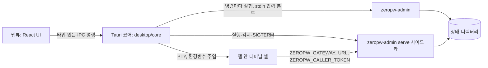

# ZeroPW 데스크톱 앱

작성일: 2026-10-15 · 구현 명세 · 이슈 [#19](https://github.com/telicity-ai/zeropw/issues/19)

이 문서는 ZeroPW 관리 기능을 Rust + Tauri v2 데스크톱 앱으로 제공하는 방법을 정한다. 화면과 움직임의 규칙은 [DESIGN.md](../DESIGN.md)에, 승인된 온보딩 목업은 [desktop/mockup/onboarding.html](../desktop/mockup/onboarding.html)에 있다. [제품 정의](product-intent.md)와 [보안 경계](security-design.md)의 요구사항은 바꾸지 않는다.

## 1. 범위

- 관리자가 쓰는 기능 전부를 화면으로 옮긴다: 보관함 만들기, 프로젝트·환경, 키(환경변수 포함), 서비스 연결, 에이전트와 권한, 사용 기록·알림, 전체 정지·재개, 사고 처리, 백업·복원·복구, 팀 공유.
- 팀 초대는 24시간 동안 한 번만 쓸 수 있는 링크(`zeropw://join#…`)로 주고받는다. 링크를 열면 미리보기만 띄우고 자동으로 합류하지 않는다.
- 에이전트 설정처럼 셸에서 하던 일은 앱 안 터미널에서 미리 채운 명령을 엔터로 실행해 끝낸다.
- 첫 실행 온보딩에는 서비스 연결을 넣지 않는다. 연결은 대시보드에서 만든다(2026-10-15 사용자 결정).

하지 않는 것: 원본 비밀을 에이전트에게 주는 호환 경로, 일괄 평문 내보내기, 모든 CLI 호환 약속, 앱 서명·공증·자동 업데이트, 같은 macOS 계정의 에이전트로부터 보관함을 격리하는 일(§9).

## 2. 구조

- **관리 명령은 명령마다 `zeropw-admin` 자식 프로세스로 실행한다.** 비밀번호와 키 값은 argv나 환경변수가 아니라 stdin의 입력 봉투(§3.1)로 넘긴다. 앱 프로세스는 KMS 키를 메모리에 올리지 않는다. CLI에만 있는 검사(감사 기록, CLI 환경변수 검사, 공유 환경 분기, 재인증)를 그대로 거치므로 CLI와 앱의 동작이 갈라지지 않는다.
- **`serve`는 따로 띄우는 사이드카다.** 고정 포트(기본 `127.0.0.1:47380`), `--quiet`, 표준 오류는 앱 데이터 폴더의 0600 로그 파일로 보낸다. 창을 닫아도 계속 돌고, 앱을 끝낼 때 SIGTERM을 보낸다.
- **웹뷰는 원본 비밀을 받지 않는다.** 입력은 웹뷰에서 Rust로만 간다. 예외는 사용자가 패스워드를 다시 넣고 요청한 단일 비밀 조회, 새 에이전트의 호출 토큰, 초대 링크, 처음 한 번 보여 주는 복구 코드다. 앞의 셋은 일회용 보관소(§4.3)의 참조로만 돌려주고 `onetime_show`나 `onetime_copy`로 한 번만 나간다. 복구 코드는 `recovery_generate` 응답의 `groups`로 한 번 나가고, 보관소에 남은 값은 `vault_init`만 읽는다(`onetime_show`·`onetime_copy`로 다시 꺼낼 수 없다).
- 데스크톱 코드는 `zeropw` 크레이트를 링크하지 않는다. 같은 디렉터리에 함께 배포한 `zeropw-admin`, `zeropw_session`, `zeropw-agent` 바이너리만 실행한다.

## 3. 제품 쪽 변경 (`rust/`)

### 3.1 입력 봉투 `--input-envelope`

`zeropw-admin --state-dir DIR --input-envelope COMMAND …` 형태의 전역 옵션을 더한다.

- 시작할 때 stdin을 한 번 읽는다(최대 256 KiB). 내용은 JSON 객체이며 다음 문자열 필드만 허용한다. 모르는 필드, 문자열이 아닌 값, 크기 초과는 `UsageError`/`envelope_invalid`로 거부하고 값을 출력하지 않는다.
  - `admin_passphrase`
  - `recovery_passphrase`
  - `value_b64`: `secret put --stdin`, `rotation start --stdin`에 쓸 값(표준 base64)
  - `invite`: `team join --stdin`, `team invite-info --stdin`에 쓸 초대 문자열이나 링크
- 봉투가 있으면 `passphrase()`는 봉투에서만 읽는다. 해당 필드가 없으면 환경변수나 터미널로 넘어가지 않고 `passphrase_missing`으로 실패한다.
- 봉투가 있을 때 `--stdin`은 stdin을 다시 읽지 않고 `value_b64`를 쓴다. 없으면 `secret_source_required`다.
- 봉투에서 읽은 값은 `Zeroizing`으로 들고 다니며 명령이 끝나면 지운다.
- 봉투가 없으면 지금과 똑같이 동작한다. 기존 출력 JSON은 바뀌지 않는다.

CLI는 재인증을 받지 않지만 앱은 받아야 하는 명령(`resume`, `connection create-http`·`create-ssh`, `grant create`, `approvals approve`, `team invite`, `team remove`, `restore`)에는 숨은 전역 옵션 `--require-admin`을 함께 넘긴다. 이 옵션은 `--input-envelope`와 같이 쓸 때만 받고, 봉투 없이 쓰면 `UsageError`다. 명령을 실행하기 전에 봉투의 `admin_passphrase`를 CLI가 재인증할 때 쓰는 경로(`verify_admin`) 그대로 확인한다. 비밀번호가 틀리거나 없으면 `auth_failed` 감사 기록(`state`는 `require_admin`)을 남기고 그 오류(`admin_reauth_failed`, `passphrase_missing`)로 멈추며, 상태는 바뀌지 않는다. 감사 기록을 쓸 수 없는 상태 디렉터리에서는 확인하기 전에 거부한다. 확인을 통과하면 명령은 옵션이 없을 때와 똑같이 돌고, `incident close`처럼 원래 재인증하는 명령은 비밀번호를 한 번 더 확인한다. `--input-envelope`처럼 도움말과 사용법에는 나오지 않는다. `rust/tests/admin_input_envelope.rs`가 틀리거나 빠진 비밀번호, 맞는 비밀번호, 봉투 없이 쓴 경우, 이미 재인증하는 명령을 시험한다.

같이 읽기 전용 명령 `zeropw-admin status`를 더한다. 출력은 `stop-all`·`resume`과 같은 `{stopped, restore_pending, incident_open}`이다. 앱이 정지 상태를 바꾸지 않고 읽을 때 쓴다.

시험(`rust/tests/admin_input_envelope.rs`): 봉투의 비밀번호로 `init`·`secret reveal`·`incident close`가 되는지, 봉투가 있을 때 `ZEROPW_ADMIN_PASSPHRASE`를 무시하는지, 필드가 없으면 `passphrase_missing`인지, 잘못된 봉투가 값을 되풀이하지 않고 거부되는지, `secret put --stdin`이 `value_b64`를 쓰는지, 오류 출력과 감사 기록에 봉투 값이 없는지.

### 3.2 하루짜리 초대 링크

기존 초대 문자열(`team invite`가 출력하는 base32 문자열, 와이어 형식)은 바꾸지 않고 링크로 감싼다.

- 링크 형식: `zeropw://join#<초대 문자열>`. `zeropw://join/#…`도 받는다. 스킴·호스트는 대소문자를 가리지 않고, 질의 문자열·사용자 정보·포트·추가 경로·퍼센트 인코딩·공백·두 번째 `#`가 있으면 거부한다. 최대 4096바이트.
- `team invite --env P/E --role R --name N --address H:P [--link]`: `--link`를 주면 유효 기간을 24시간으로 고정하고(`--ttl`이 24시간이 아니면 `invite_link_ttl_fixed`), 출력에 `link`, `invite_id`(초대 비밀 SHA-256 앞 16바이트의 16진수), `expires_at`을 더한다. `--link`가 없으면 출력은 지금과 같다.
- `team invites --env P/E`: 이 기기가 만든 초대 목록. `{env_id, invites:[{invite_id, role, name, link, created_at, expires_at, status, used_at, used_by, revoked_at}]}`. `status`는 `pending|used|expired|revoked`. 비밀·암호문은 나오지 않는다.
- `team revoke-invite --env P/E --id ID`: 아직 쓰이지 않은 초대만 막는다. 다시 불러도 성공한다. 없는 ID는 `invite_not_found`, 이미 쓰인 초대는 `invite_already_used`. 감사 기록 `team_invite_revoke`.
- `team invite-info --stdin`: 봉투의 `invite`(또는 봉투 없이 stdin)를 읽어 네트워크 없이 미리보기를 낸다. `{env_id, inviter, addresses, role, name, expires_at, expired, invite_id}`.
- `team join --stdin [--project P --environment E]`: 초대를 argv 대신 봉투나 stdin으로 받는다. 위치 인자도 계속 받는다. 링크 형식도 받는다. 연결하기 전에 만료 여부를 로컬에서 먼저 확인한다(시계 차이 300초 허용, `invite_expired`).
- 상태 파일 `team/<env-id>/invites.json` 항목에 선택 필드 `created_at`, `revoked_at`, `used_at`, `used_by`를 더한다. 예전 항목도 그대로 읽는다. 쓰였거나 취소된 항목은 `wrapped_secret`을 지운다.
- 미리보기·참여 쪽에서 파싱한 초대도 주소는 16개, 각 128바이트까지만, `HOST:PORT` 모양만 받는다. `inviter`는 26자 지문 형식이어야 한다.

시험(`rust/tests/team_invite_link.rs` 등): 링크와 초대 문자열 왕복, 잘못된 링크 거부(입력 비반사), 1회 사용, 정확히 24시간 만료, 취소한 초대 거부, 취소와 사용 경합에서 한쪽만 성공, 목록에 비밀 없음, 예전 항목 호환, CLI 출력 키.

## 4. 데스크톱 코어 (`desktop/core`)

Tauri에 의존하지 않는 Rust 라이브러리다. 모든 로직과 시험은 여기 둔다.

### 4.1 AdminRunner

- `run(args, envelope) -> Result<Value, AppError>`: `zeropw-admin --state-dir <dir> --input-envelope <args…>`를 실행한다. 환경은 비우고 `PATH=/usr/bin:/bin`, `HOME`, `LANG=C.UTF-8`, `TMPDIR`만 준다. 봉투 JSON을 stdin에 쓰고 닫는다. 기본 제한 시간 60초, `team join`은 90초.
- 성공하면 stdout JSON을, 실패하면 stderr의 `{error, reason, detail}`을 `AppError`로 돌려준다. 다른 출력은 버린다.
- 인자는 타입 있는 입력에서만 만든다. 값은 `--flag=value` 형태로 넣어 옵션으로 오인되지 않게 하고, 위치 인자는 미리 형식을 검사한다. 비밀 값은 argv에 넣지 않는다.
- 바이너리 위치: 앱 실행 파일과 같은 폴더(번들), 개발 중에는 `ZEROPW_BIN_DIR`.

### 4.2 ServeSupervisor

- 시작: `zeropw-admin --state-dir D serve --listen 127.0.0.1:<port> [--team-listen IP:PORT] --quiet`, 환경은 4.1과 같다. 첫 stdout 줄의 JSON에서 `url`을 읽고 `/healthz`가 200을 줄 때까지 기다린다(60초).
- 단일 인스턴스: 앱 데이터 폴더의 `serve.json`(pid, url, 시작 시각). 다시 켤 때는 pid가 살아 있고 `/healthz`와 `Server: zeropw-prototype` 헤더가 맞을 때만 이어 붙는다.
- 중지: SIGTERM, 최대 25초 기다린 뒤에만 SIGKILL.

### 4.3 일회용 보관소 (OneTimeStore)

복구 코드, 호출 토큰, 초대 링크, 다시 본 비밀 값, 붙여 넣거나 링크로 받은 초대를 `Zeroizing` 버퍼로 잠깐 들고 있는다. 무작위 128비트 참조로 꺼내며, 한 번 보여 주면 지운다. 수명은 비밀 값 60초, 나머지 10분. `Debug`·`Serialize`를 구현하지 않는다.

- 항목마다 종류가 있어서 다른 용도로 꺼낼 수 없다. 웹뷰로 나갈 수 있는(`onetime_show`·`onetime_copy`) 것은 호출 토큰, 초대 링크, 다시 본 값뿐이다. 복구 코드는 `vault_init`만, 받은 초대는 `team_join`만 읽는다.
- 앱이 만든 값은 예약까지 합쳐 256개까지 든다. CLI 호출이 상태를 바꾸고 값을 한 번만 출력하는 명령(`principal_create`의 토큰, `team_invite_create`의 링크, 감사 기록을 남기는 `secret_reveal`)은 CLI를 실행하기 전에 자리를 예약한다. 보관소가 가득 차면 아무것도 바꾸기 전에 `onetime_store_full`로 거절하고, 만든 뒤에 값을 잃는 일은 없다.
- 붙여 넣거나 딥 링크로 받은 초대는 따로 16개까지 들고, 넘치면 가장 오래된 것부터 버린다. 앱 밖에서 링크를 아무리 열어도 앱이 만든 값의 자리를 차지하지 못한다.

### 4.4 앱 안 터미널

- `portable-pty`로 사용자의 로그인 셸을 띄운다. 환경에 `ZEROPW_GATEWAY_URL`, `ZEROPW_CALLER_TOKEN`, `no_proxy=127.0.0.1,localhost`를 넣고, `PATH` 앞에 번들 바이너리 폴더를 둔다. 토큰은 키 입력으로 넣지 않으므로 화면과 셸 기록에 남지 않는다.
- 다른 macOS 계정에서 실행할 때 첫 제안 명령은 `sudo --preserve-env=ZEROPW_GATEWAY_URL,ZEROPW_CALLER_TOKEN,no_proxy -u <계정> -i`다.
- 제안 명령은 프롬프트에 입력만 해 두고 사용자가 엔터를 누르면 실행된다. 두 번째 제안은 `<번들 경로>/zeropw-agent list-connections`.
- 출력은 Tauri 채널로 웹뷰의 xterm.js에 보낸다.
- 키 입력(`terminal_write`)은 터미널마다 있는 쓰기 스레드의 큐에 넣고 바로 돌아온다. 실행 중인 프로그램이 입력을 읽지 않으면 PTY 쓰기가 끝나지 않을 수 있으므로, 쓰기는 터미널 목록의 잠금 밖에서 그 스레드만 한다. 읽히지 않은 입력이 256 KiB를 넘으면 기다리지 않고 `terminal_busy`로 거절한다. 목록, 다시 붙기, 크기 바꾸기, 닫기, 앱 종료는 막히지 않는다.
- 읽기·쓰기 스레드는 PTY를 비차단 모드로 쓰고, PTY와 그 터미널의 멈춤 파이프를 함께 기다린다(Linux는 `poll`, macOS는 `select`). 커널 안에서 멈춘 쓰기는 프로그램이 끝나도 깨어나지 않을 수 있기 때문이다. 그래서 붙여 넣기가 막힌 채로 터미널을 닫아도 두 스레드가 끝나고, 아직 쓰지 못한 입력은 지우고 버린다.
- 토큰은 셸과 셸에서 시작한 모든 프로세스의 환경에 있다. 그래서 터미널을 닫거나(`terminal_close`) 앱을 끝내면 셸만이 아니라 그 터미널에서 시작한 프로세스를 모두 멈춘다. 셸의 프로세스 그룹, 셸 자손의 그룹, 이 PTY를 제어 터미널로 쓰는 프로세스의 그룹(부모가 먼저 끝난 프로세스도 포함)에 SIGHUP과 SIGCONT를 보내고, 2초 뒤에도 남은 것은 SIGKILL로 끝낸다. 그 터미널의 읽기·쓰기 스레드가 끝나기를 기다려(최대 2초) PTY와 파이프를 모두 닫은 다음에 돌아온다. 앱 종료는 모든 터미널에 같은 과정을 한 번에 거친다.
- 닿지 않는 것: `setsid`와 이중 fork로 세션과 프로세스 트리를 모두 떠난 프로세스(데몬), 다른 계정으로 도는 프로세스(`sudo -u`). 다른 계정의 프로세스는 앱이 신호를 보낼 수 없어서 셸이 끝날 때 커널이 보내는 끊김 신호만 받는다. 이런 프로세스에 남은 토큰은 에이전트를 끄는 것(`principal_disable`)으로만 막을 수 있다.
- 터미널은 화면을 떠나도 닫지 않는다. 에이전트가 계속 돌아야 하기 때문이다. 출력은 터미널마다 256 KiB 링 버퍼에 남고, 에이전트 화면이 `terminal_list`로 목록을 받아 `terminal_attach`로 다시 붙으면 버퍼를 먼저 재생한 뒤 이어서 보낸다. 채널은 출력만 나르므로 셸이 끝났는지는 `terminal_list`의 `alive`로 안다.

### 4.5 설정과 경로

- 상태 디렉터리: 앱 데이터 폴더의 `state/` (macOS `~/Library/Application Support/ZeroPW/state`).
- 앱 설정 `settings.json`(0600): 중계기 포트, 팀 동기화 주소. 상태 디렉터리 안에는 쓰지 않는다.
- 파일 선택(키 파일, CA, 백업)은 Rust에서 네이티브 창을 열고 경로를 불투명한 `file_token`으로만 웹뷰에 알린다.

## 5. IPC 명령

모든 명령은 실패하면 `AppError {error, reason, detail?}`를 돌려준다. 입력값은 어떤 오류에도 되풀이하지 않는다. "재인증"은 관리 비밀번호를 함께 받아 봉투로 넘긴다는 뜻이다. CLI가 스스로 재인증하지 않는 명령에는 `--require-admin`을 붙인다(§3.1). 비밀번호가 비어 있으면 코어가 CLI를 부르기 전에 거절한다.

| 명령 | 입력 | 출력 | CLI | 재인증 |
| --- | --- | --- | --- | --- |
| `app_status` | | `{initialized, state_dir, serve, control}` | 상태 디렉터리 확인, `status` | |
| `password_strength` | `{value}` | `{score, reason}` | 코어의 zxcvbn. 입력이 바뀔 때마다 값이 IPC로 온다(§7) | |
| `recovery_generate` | | `{ref, groups[6]}` | 코어 CSPRNG, 값은 보관소 | |
| `vault_init` | `{admin_passphrase, recovery: {ref}\|{typed}}` | `{state_dir, kms_key_id}` | `init` 후 `serve` 시작 | 두 비밀번호 |
| `serve_start` / `serve_stop` / `serve_status` | | `ServeStatus` | §4.2 | |
| `control_get` / `stop_all` / `resume` | | `{stopped, restore_pending, incident_open}` | `status`, `stop-all`, `resume` | `resume`은 재인증 |
| `project_list` / `project_create` | `{name, environments[]}` | 프로젝트 | `project …` | |
| `secret_list` / `secret_versions` | `{project?, environment?}` / `{id}` | 값 없는 목록 | `secret list/versions` | |
| `secret_put` | `{id, kind, project, environment, source}` | 버전 정보 | `secret put --stdin` | |
| `secret_reveal` | `{id, version?, admin_passphrase}` | `{ref, id, version}` | `secret reveal` | 매번 |
| `secret_retire` / `secret_revoke` | `{id, version}` | CLI 출력 | `secret retire/revoke` | |
| `connection_list` / `connection_create_http` / `connection_create_ssh` / `connection_disable` | 연결 필드 | CLI 출력 | `connection …` | 만들기 재인증 |
| `principal_list` / `principal_create` / `principal_disable` | `{id, runtime}` | 생성 시 `{id, runtime, token_ref}` | `principal …` | |
| `grant_list` / `grant_create` / `grant_revoke` | `{principal, connection, ttl, max_uses?}` | 권한 정보 | `grant …` | 만들기 재인증 |
| `terminal_open` / `terminal_write` / `terminal_resize` / `terminal_close` | `{token_ref, as_user?}` 등 | `{terminal_id, suggestions[]}`, 출력은 채널. `terminal_write`는 `terminal_busy`일 수 있고 `terminal_close`는 그 터미널의 프로세스를 멈춘 뒤 돌아온다 | §4.4 | |
| `terminal_list` / `terminal_attach` | 없음 / `{terminal_id}`와 출력 채널 | `{terminals[{terminal_id, principal, as_user, alive}]}` / `{terminal_id, suggestions[]}`, 버퍼를 채널로 재생한 뒤 이어서 보낸다 | §4.4 | |
| `secure_view` | `{on}` | `{protected}`: 창이 실제로 화면 캡처에서 빠졌는지. Linux에서는 늘 `false` | 창 내용 보호(§8.8) | |
| `audit_tail` / `alerts` | `{limit}` | 값 없는 기록 | `audit tail`, `alerts` | |
| `approvals_list` / `approvals_approve` | `{digest}` | 승인 정보 | `approvals …` | 승인 재인증 |
| `incident_list` / `incident_show` / `incident_declare` / `incident_close` | 사건 필드 | 사건 정보 | `incident …` | `all` 범위·종료 |
| `backup_create` / `backup_restore` / `restore_ack` / `recover` | 파일은 Rust 창. `backup_restore`·`restore_ack`는 `{admin_passphrase}`, `recover`는 `{recovery_passphrase}` | CLI 출력 | `backup`, `restore`, `restore-ack`, `recover` | `backup_restore`(`--require-admin`), `restore_ack` 재인증, `recover`는 복구 코드 |
| `team_init` / `team_share` / `team_members` / `team_remove` | | CLI 출력 | `team …` | `share`·`remove` 재인증 |
| `team_invite_create` | `{env, role, name, address}` | `{invite_id, link_ref, expires_at, inviter}` | `team invite --link` | 재인증 |
| `team_invites` / `team_revoke_invite` | `{env}` / `{env, invite_id}` | 목록 / 결과 | §3.2 | |
| `team_invite_preview` | `{text}` | `{ref, preview}` | `team invite-info --stdin` | |
| `team_join` | `{ref, project?, environment?}` | 합류 결과 | `team join --stdin` | |
| `onetime_show` / `onetime_copy` / `onetime_discard` | `{ref}` | 한 번만 값 / 복사 결과 | 보관소 | |
| `file_pick` | `{purpose}` | `{file_token, name}` | 네이티브 창 | |
| `settings_get` / `settings_set` / `net_interfaces` | | 설정 / 주소 목록 | 코어 | |

딥 링크(`zeropw://join#…`)를 받으면 코어가 `team invite-info`를 돌려 `invite://preview` 이벤트로 `{ref, preview}`만 보낸다. 합류는 사용자가 확인 화면에서 누를 때만 일어난다. 딥 링크는 합류 화면을 채우는 일 말고는 어떤 동작도 하지 않는다.

`secret_reveal`·`secret_retire`·`secret_revoke`의 `version`은 CLI가 `secret_list`·`secret_versions`에 출력한 값 그대로다. CLI는 버전을 JSON 숫자로 출력하지만 코어는 숫자와 문자열(영숫자, `-`, `_`, 64자 이하)을 모두 받아 바꾸지 않고 `--version=<값>`으로 넘긴다. 받아들일지는 CLI가 정한다.

코어가 보내는 이벤트는 `invite://preview`, `control://changed`, `serve://status`다. 계약의 `audit://records`는 자리만 있고 코어는 아직 보내지 않는다. 대시보드는 `audit_tail`을 주기적으로 다시 불러 새 기록을 안다.

`recover`는 복구 코드를 두 가지 형태로 시도할 수 있다. 앱이 만든 보관함은 표준형(`XXXX-XXXX-…`, 대문자 base32)을 저장했고, `zeropw-admin init`에 직접 넣은 보관함은 입력한 그대로를 저장했기 때문이다. 입력이 복구 코드 모양(하이픈과 공백을 빼면 base32 24자)인데 표준형과 다르면 표준형으로 먼저 시도하고, CLI가 `AuthFailed`로 답할 때만 입력 그대로 한 번 더 시도한다. 그 밖에는 한 번만 부른다. 그래서 요청 한 번에 CLI 호출은 최대 두 번이고, 틀린 코드는 `auth_failed` 감사 기록을 최대 두 줄 남긴다.

## 6. 기능과 화면

| 화면 | 기능 | 쓰는 명령 |
| --- | --- | --- |
| 온보딩 | 관리 비밀번호, 복구 코드, 보관함 만들기, 첫 프로젝트, 에이전트 연결(터미널) | `password_strength`, `recovery_generate`, `vault_init`, `project_create`, `principal_create`, `terminal_open` |
| 상단 막대 | 중계기 상태, 전체 정지·재개 | `serve_status`, `control_get`, `stop_all`, `resume` |
| 홈 | 상태 요약, 최근 알림 | `app_status`, `alerts` |
| 키 | 비밀·환경변수 목록과 추가, 다시 보기, 교체·폐기 | `secret_*`, `onetime_*` |
| 연결 | API·SSH 연결 만들기, 범위, 끄기 | `connection_*`, `file_pick` |
| 에이전트 | 에이전트와 권한, 앱 안 터미널, 승인 대기 | `principal_*`, `grant_*`, `terminal_*`, `approvals_*` |
| 기록 | 사용 기록, 알림, 사고 | `audit_tail`, `alerts`, `incident_*` |
| 팀 | 공유, 팀원, 초대 링크, 합류 | `team_*` |
| 설정 | 중계기 포트, 이 기기 주소, 백업·복원·복구 | `settings_*`, `net_interfaces`, `backup_*`, `restore_ack`, `recover` |

환경변수는 `env_var` 종류의 비밀이다. 값은 중계기가 인증에 쓸 뿐 어느 프로세스의 환경변수로도 들어가지 않는다는 점을 키 화면에서 한 줄로 알린다.

## 7. 온보딩 흐름

1. **시작**: 시작하기 또는 초대받았어요.
2. **관리 비밀번호**: 8자 이상, 두 칸 일치, 강도 점수 기준 통과. 강도는 Rust의 zxcvbn이 매기므로 입력이 바뀔 때마다 그때까지 친 값이 `password_strength`로 IPC를 건너간다(점수와 이유만 돌아온다). 보관함을 만들 때 `vault_init`로 한 번 더 넘어간다.
3. **복구 코드**: Rust가 120비트 코드를 만들어 여섯 칸으로 보여 준다. 적어 두었다고 표시하면 두 칸을 다시 입력해 확인한다. 직접 정할 때는 더 높은 강도를 요구하고 관리 비밀번호와 같으면 막는다. 직접 정한 값도 2단계처럼 입력할 때마다 `password_strength`로 넘어간다.
4. **보관함 만들기**: `vault_init` → `serve_start`. 목록의 점이 하나씩 켜지고 마지막에 구체가 터진다.
5. **프로젝트**: 이름과 환경(dev, staging, prod). 환경은 나중에 바꿀 수 없다.
6. **에이전트 연결**(나중에 가능): 이름, 실행할 곳(다른 계정 추천 / 이 계정). `principal_create` 뒤 터미널을 연다. 서비스 연결이 없으므로 권한은 대시보드에서 준다.
7. **완료**: 대시보드로.

초대받기 경로는 링크 확인 → 2~4단계 → 합류다.

## 8. 보안 경계

1. 관리 기능은 Tauri IPC로만 노출한다. 루프백 HTTP, 웹소켓, MCP로 내보내지 않는다.
2. 명령은 하나하나 타입을 정하고 앱 매니페스트로 허용 목록을 고정한다. argv를 그대로 넘기는 명령, 임의 파일 읽기·쓰기, URL 열기는 없다.
3. CSP: `default-src 'self'; script-src 'self'; style-src 'self' 'unsafe-inline'; img-src 'self' data:; font-src 'self'; connect-src ipc: http://ipc.localhost; object-src 'none'; base-uri 'none'; form-action 'none'; frame-ancestors 'none'`. 원격 리소스와 `devUrl`은 배포 빌드에 없다. 글꼴 파일은 넣지 않고(저장소에 바이너리를 커밋하지 않는다) 설치된 글꼴을 쓴다.
   `Object.prototype`은 페이지 스크립트보다 먼저 얼린다. Tauri의 `freezePrototype`은 그냥 `Object.freeze`라서 xterm.js가 읽어 들일 때 `toString`을 대입하다 멈춘다. 그래서 셸이 `src-tauri/src/freeze_prototype.js`를 초기화 스크립트로 넣는다. 데이터 속성을 접근자로 바꿔 상속받은 이름에 대입하면 받는 객체에 자기 속성이 생기게 한 뒤(SES의 override taming) 얼린다. 프로토타입 자체에는 여전히 속성을 더하거나 바꿀 수 없다. 설정의 `freezePrototype`은 `false`이고, `scripts/check-tauri.mjs`가 이 스크립트의 연결과 동작을 확인한다.
4. 플러그인은 Rust에서만 쓴다(딥 링크, 단일 인스턴스(macOS 제외, §10), 대화상자). 클립보드는 플러그인 없이 Rust의 arboard로 쓴다. 웹뷰 권한은 `core:default`, 겹친 제목 막대로 창을 끌기 위한 `core:window:allow-start-dragging`, 계약 명령의 `allow-*`뿐이다. shell·fs·http·opener 플러그인은 넣지 않는다. 대화상자 플러그인이 `tauri-plugin-fs`를 라이브러리로 끌어오지만 등록하지 않고 권한도 없다.
5. 신뢰할 수 없는 문자열(승인 요청의 경로, 감사 기록 필드, 팀원 이름)은 텍스트로만 그린다. `innerHTML`과 `dangerouslySetInnerHTML`은 lint로 막는다.
6. 비밀번호는 `Zeroizing<String>`으로 받아 봉투로 넘기고 곧바로 지운다. 어떤 환경변수에도 넣지 않는다. 웹뷰 상태 저장소, 로그, 이벤트에 남기지 않는다.
7. 클립보드는 사용자가 누를 때만 Rust에서 쓰고, 60초 뒤 내용이 그대로면 비운다. 그 전에 앱을 끝내면 끝낼 때 같은 확인을 하고 비운다. 앱이 강제로 끝나면(강제 종료, 충돌) 비우지 못한다. 값에는 클립보드 기록에서 빼 달라는 표시를 붙인다(macOS `org.nspasteboard.ConcealedType`, Linux `x-kde-passwordManagerHint`). 이 표시를 따르지 않는 기록 도구는 값을 남길 수 있고, macOS의 유니버설 클립보드는 같은 Apple 계정의 다른 기기로 값을 보낼 수 있다. 웹뷰는 클립보드를 읽지 못한다.
8. 복구 코드·토큰·초대 링크·다시 본 값이 화면에 있는 동안 창 내용 보호(화면 캡처 차단)를 켠다. macOS와 Windows에서만 된다. Linux의 창 시스템에는 이런 장치가 없어서 `secure_view`가 `{protected: false}`를 돌려준다. 그때 화면은 캡처를 막는다고 말하지 않는다.
9. 같은 macOS 계정에서 도는 프로그램은 개발용 KMS 키 파일을 읽을 수 있다. 이 사실을 보관함 만들기 화면과 에이전트 실행 위치 선택에서 알린다. 실제 격리(신뢰 프로세스를 별도 계정의 데몬으로 실행)는 후속 이슈 [#21](https://github.com/telicity-ai/zeropw/issues/21)에서 다룬다.

## 9. 빌드·시험·CI

- 배치: `desktop/`에 별도 Cargo 워크스페이스(`core`, `src-tauri`)와 `package.json`. 루트 워크스페이스는 만들지 않으며 `rust/`의 빌드와 `rust/verify.sh`는 그대로다.
- 아이콘은 바이너리로 커밋하지 않는다. `src-tauri/build.rs`가 픽셀 로고 PNG를 생성한다.
- 개발 실행: `npm run tauri dev`(Vite 1420번 포트). 사이드카는 디버그 빌드에서 `ZEROPW_BIN_DIR`로 가리킨다.
- 배포 빌드: `npm run bundle`. `scripts/prepare-sidecars.sh`가 `rust/`에서 `zeropw-admin`, `zeropw_session`, `zeropw-agent`를 릴리스로 빌드해 `src-tauri/binaries/<이름>-<타깃>`으로 복사하고, `tauri.bundle.conf.json`이 이들을 `externalBin`으로 묶는다.
- `desktop/verify.sh`: `npm ci`, `tsc --noEmit`, lint, `vitest run`, `vite build`, `cargo fmt --check`, `cargo clippy -D warnings`, `cargo test`(실제 `zeropw-admin`으로 임시 상태 디렉터리를 쓰는 통합 시험 포함), 정적 검사(CSP·capabilities·금지 플러그인·`innerHTML`).
- CI: `.github/workflows/harness-ci.yml`에 `desktop-tests` 작업(ubuntu-latest, macos-15)을 더한다. 우분투에는 webkit2gtk 4.1 개발 패키지를 설치한다.
- 파일 크기 제한(하네스, 파일당 300,000바이트) 때문에 `package-lock.json`은 의존성을 최소로 유지한다.

## 10. 남은 한계

- 같은 macOS 계정의 에이전트로부터 보관함을 격리하지 않는다(§8.9).
- 앱 서명·공증과 자동 업데이트는 없다. 개발 빌드만 만든다.
- 팀 공유는 기존 명세대로 같은 LAN·VPN 안의 직접 연결만 지원한다.
- 창을 닫아도 앱, 중계기, 에이전트 터미널은 계속 돈다. macOS는 Dock에서 다시 열고 Cmd+Q로 끝낸다. Linux에는 트레이가 없어서 다시 실행하면 창이 열리고 `zeropw-desktop --quit`로 끝낸다.
- 앱은 사용자마다 하나만 뜬다. Linux는 단일 인스턴스 플러그인이 사용자의 D-Bus 세션 버스에서 두 번째 실행의 인자(`--quit`, `zeropw://` 링크)를 첫 실행에 넘긴다. macOS에서는 그 플러그인이 모든 계정이 같이 쓰는 `/tmp`의 고정 소켓을 써서, 다른 계정이 그 자리를 차지하면 앱이 아예 뜨지 않는다. 그래서 macOS에서는 쓰지 않는다. LaunchServices가 사용자마다 하나만 띄우고 링크는 open-url 이벤트로 오며, 실행 파일을 직접 실행하거나 `open -n`으로 띄운 두 번째 앱은 앱 데이터 폴더(0700)의 잠금 파일을 보고 끝난다. 대신 macOS에서 `--quit`는 실행 중인 앱을 끝내지 못한다.
- Linux에는 창 내용 보호가 없다. 복구 코드, 토큰, 초대 링크, 다시 본 값을 띄운 창도 스크린숏, 화면 녹화, 화면 공유에 그대로 찍힌다(§8.8).
- 터미널을 닫거나 앱을 끝내도 세션과 프로세스 트리를 떠난 프로세스와 다른 계정의 프로세스는 멈추지 못한다(§4.4). 앱이 강제로 끝나면 이 정리도 일어나지 않고, PTY가 닫힐 때 커널이 보내는 끊김 신호만 남는다.
- Linux에서 `zeropw://` 링크는 deb·AppImage로 설치해 `.desktop` 등록이 된 뒤에만 앱으로 온다. 실행 중에 스킴을 등록하지 않는다.
- 웹뷰에서 보낸 비밀번호는 Tauri IPC 버퍼에 사본이 남을 수 있다. 관리 비밀번호와 직접 정한 복구 코드는 강도 확인 때문에 입력이 바뀔 때마다 그때까지의 값이 넘어가므로 사본이 여럿일 수 있다(§7). 코어로 넘어온 뒤에는 `Zeroizing`으로 지운다.
- 관리 비밀번호를 바꾸는 기능은 아직 없다. 사고 종료 절차가 요구하는 비밀번호 교체 단계는 화면에서 수동 단계로 안내한다.
