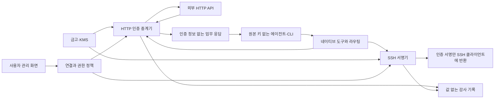

# ZeroPW 인증 중계와 보안 경계

작성일: 2026-09-12 · 현행 설계 · 구현 전 요구사항

## 1. 보호할 경계

에이전트, CLI, 에이전트가 작성한 코드, 작업 파일과 도구 응답에는 원본 비밀을 제공하지 않는다. 비밀을 보유하는 금고·인증 중계기·서명기는 별도의 신뢰 영역에 둔다. 인증 중계기는 에이전트가 보낸 코드를 실행하지 않는다.

클라우드 실행 환경은 신원, 파일·프로세스 접근, 네트워크와 관리 권한을 분리해야 한다. 같은 호스트에서 프로세스만 둘로 나누고 디버깅·볼륨·관리 권한을 공유하는 구성을 격리로 인정하지 않는다. 비밀은 KMS 기반 암호화와 최소 권한으로 보호하며 신뢰 서비스 사이의 통신도 인증한다.

에이전트가 받는 제한된 사용 권한과 금고의 원본 자격증명은 다르다. 에이전트는 허용된 사용 권한을 행사하거나 유출할 수 있다. 따라서 짧은 만료, 대상과 권한 제한, 사용량 제한, 회수와 감사가 필요하다. 신뢰 영역 침해나 이미 허용한 행위의 피해까지 원본 비밀 비전달로 해결되는 것은 아니다.

## 2. 인증 경로

HTTP 요청에서는 중계기가 연결 정책을 확인하고, 허용된 대상에 보내는 요청에만 인증 정보를 넣는다. 응답에서는 인증 정보를 제거·차단한 뒤 업무 결과를 반환한다. 원본 키를 CLI에 돌려주지 않는다.

SSH에서는 클라이언트가 서버와 통신하고 서명기는 인증에 필요한 서명만 제공한다. SSH 세션의 명령 실행을 서명기가 대리하는 구조가 아니다. 서명은 검증된 SSH 인증 요청과 목적지에 묶고, 임의 바이트 서명이나 다른 용도의 서명에 같은 키를 사용하게 하지 않는다.

## 3. 연결과 네이티브 도구 계약

도구 이름은 구현 시 조정할 수 있지만 다음 계약은 유지한다.

| 도구 | 입력과 결과 |
| --- | --- |
| list_connections | 호출 주체가 사용할 수 있는 연결 ID, 설명, 지원 방식과 권한만 반환한다. 비밀값과 다른 사용자의 연결은 노출하지 않는다. |
| exec | 연결과 명령·인자를 받아 비밀이 없는 실행 환경에서 지원 CLI를 실행한다. 라우팅과 인증 위임을 설정하며 일반 업무 출력과 실행 상태를 반환한다. |
| request | 연결 ID와 HTTP 메서드·상대 경로·요청 내용을 받는다. 허용 대상에서만 인증을 처리하고 업무 응답을 반환한다. |
| status / cancel | 본인 권한에 속하는 실행의 상태를 확인하거나 취소한다. 비밀이나 인증 헤더를 반환하지 않는다. |

어떤 도구도 원본 비밀의 조회·내보내기를 제공하지 않는다. 모든 호출은 신원과 연결 소유권을 확인한다. exec는 신뢰하는 중계기 안에서 사용자 코드를 실행하지 않으며, request는 임의 호스트로 자격증명을 전송하는 기능이 아니다.

실행 환경에 전달하는 연결용 토큰이나 핸들은 원본 키와 분리하고 호출 신원·연결·대상·기간·사용량에 제한을 둔다. 도구가 지원하지 않는 CLI 인증 방식을 만나면 미지원 오류를 반환한다. 비밀을 환경변수·파일·인자에 넣거나 credential helper로 반환하는 대체 경로는 없다.

## 4. 프로토콜별 통제와 호환성

| 경로 | 필수 통제 |
| --- | --- |
| HTTP 라우팅 | 연결의 대상 호스트·포트·TLS 서버 신원을 검증한다. 임의 호스트, 개방형 CONNECT, 리다이렉트, DNS 변경을 통한 내부망·메타데이터 접근이나 인증 정보 전달을 막는다. |
| HTTP 인증 | 외부로 나가는 요청에만 자격증명을 삽입한다. 호출자가 인증 헤더나 연결 선택을 조작해 다른 비밀을 쓰거나 읽지 못하게 한다. |
| HTTP 응답 | 일반 업무 응답은 제공한다. 인증 헤더 반사, 자격증명 조회·발급, 디버그 경로와 인증 정보가 포함된 오류·스트림은 서비스 특성에 맞게 제한한다. |
| SSH 인증 | SSH agent 프로토콜과 세션·목적지 결합을 검증한다. 검증할 수 없는 클라이언트는 미지원으로 처리한다. 개인키 내보내기, 범용 서명, agent forwarding은 기본 허용하지 않는다. |
| 로그·추적·임시 파일 | 요청 인증값과 금고 값을 남기지 않는다. 디버깅·충돌 보고·프록시 추적·오류 로그도 같은 기준으로 통제한다. |

HTTPS CONNECT 터널만으로 암호화된 요청의 인증 헤더를 바꿀 수는 없다. 중계 가능한 base URL, 안전한 TLS 종단 방식 또는 해당 CLI의 공식 인증 위임 경로를 검증해야 한다. 인증서 고정이나 로컬 평문 자격증명을 요구하는 CLI는 지원이 어려울 수 있다.

서비스별 지원 프로필은 인증 방식, 대상, 자격증명을 노출하는 경로, 응답 처리와 호환 클라이언트를 정의한다. 이는 제품 통합 코드의 책임이며 사용자가 명령이나 API 작업을 매번 등록하는 절차가 아니다. 허용 범위 안의 다양한 요청은 같은 연결을 사용한다.

단순 문자열 마스킹으로 변형·인코딩된 유출까지 보장하지 않는다. 인증 정보를 반사하는 서비스 기능과 경로를 사전에 확인하고, 안전하게 중계할 수 있는 범위를 지원 목록에 명시한다. 지원 범위에서 인증 정보가 출력될 수 있는 경로를 통제하지 못하면 해당 통합을 출시하지 않는다. 외부 응답 속 지시문은 데이터이며 정책 변경 권한으로 취급하지 않는다.

## 5. 권한·승인·회수

기본값은 거부다. 권한은 호출 주체, 프로젝트·환경, 연결, 대상, 허용 행위, 만료와 사용량에 결합한다. 사용자는 연결의 범위를 설정하며, 같은 범위 안의 명령을 하나씩 사전등록하거나 매번 승인하지 않는다. 필요한 경우 삭제·결제 등 위험 행위에 추가 확인을 둘 수 있다.

사용 권한은 연결, 자격증명 버전, 대상과 정책 버전에 묶는다. 변경 시 기존 권한을 재평가하고 더 넓은 권한을 자동 승계하지 않는다. 각 요청과 서명 직전에 최신 회수·만료 상태를 확인한다. 특정 요청의 승인이 필요할 때는 입력 digest와 서버가 해석한 실제 대상·행위를 결합해 승인 뒤 입력이 바뀌지 않게 한다.

통합 코드의 릴리스 승인은 사용자 연결 권한과 별개다. 검증한 코드와 배포 산출물의 digest를 묶는 절차가 사용자에게 매 명령을 등록시키거나 호환 업데이트마다 작업을 재등록시키는 이유가 되어서는 안 된다.

즉시 회수는 회수 상태가 반영된 뒤 새로운 인증 중계·서명을 거부하고 대기 실행을 취소하는 것을 뜻한다. 진행 중인 요청은 가능한 범위에서 취소한다. 이미 외부 서비스가 처리한 작업을 되돌리거나 이미 인증된 SSH 세션을 자동 종료한다는 뜻은 아니다. 세션 강제 종료에는 대상 서버의 통제가 별도로 필요하다. 전체 실행 정지와 이상 사용 알림도 제공한다.

호출 주체와 요청 ID에 입력 digest를 연결해 중복 요청을 구분한다. 쓰기 작업의 성공 여부가 불명확하면 무조건 재시도하지 않고 상태를 확인한다. 모든 외부 서비스에 대해 exactly-once 실행을 보장하지 않는다.

## 6. 비밀과 운영 권한의 생명주기

관리 화면의 사용자 인증은 에이전트 신원과 분리한다. 비밀 입력·조회 화면을 에이전트가 조작하는 브라우저 세션에 연결하지 않는다. CORS를 권한 검사로 대신하지 않으며, 환경변수 파일 가져오기는 데이터 파싱으로 처리하고 내용을 실행하지 않는다.

사용자의 단일 비밀 조회는 재인증과 감사 기록을 요구한다. 초기에는 일괄 평문 내보내기를 제공하지 않는다. 복구 수단은 독립적으로 관리하고 복구 시 기존 세션·권한을 회수한다. 모든 복구 수단과 복호화 권한을 잃어도 항상 복구할 수 있다고 약속하지 않는다.

교체는 새 버전 등록, 인증 확인, 연결 전환, 외부 공급자에서 이전 자격증명 폐기 순서로 진행한다. 금고에서 값을 삭제하는 것만으로 공급자의 키가 폐기되지는 않는다. 암호화 백업을 복원한 뒤에는 최신 회수 상태를 적용하기 전까지 실행을 열지 않는다.

감사 기록에는 호출 주체, 연결, 대상, 행위, 결과와 정책 버전을 남기고 원본 비밀·인증 헤더는 남기지 않는다. 에이전트는 감사 저장소를 직접 읽거나 수정·삭제할 수 없다. 중계기·서명기는 필요한 기록 추가 권한만 갖고, 사용자 조회는 별도 권한으로 제공한다. 필수 감사 기록에 실패하면 인증 실행도 거부한다.

에이전트와 개발 작업자는 KMS·금고 관리자, 정책 관리자, 배포·감사·복구·백업 권한을 획득할 수 없어야 한다. ZeroPW 자신의 기반 권한과 모델 호출 키를 업무용 연결에 넣는 자기 참조 구성을 금지한다.

## 7. 구현 수용 시험

| 검증할 행동 | 통과 기준 |
| --- | --- |
| 연결 한 번으로 다양한 명령 실행 | 같은 연결에서 서로 다른 CLI·API 작업이 개별 등록 없이 성공한다. |
| 에이전트의 원본 키 추출 시도 | 환경·파일·디버깅·다른 프로세스 접근으로 원본 값이 나오지 않는다. |
| 응답·오류·로그를 통한 유출 시도 | 헤더 반사, 리다이렉트, 변형·인코딩, 스트림과 추적 경로에서 인증 정보가 노출되지 않는다. |
| 다른 연결·대상 사용 시도 | 연결 ID 교체, 대상 변조, SSH 목적지 위조와 세션 재사용이 정책을 우회하지 못한다. |
| SSH 키 오용 시도 | 키 내보내기, 범용 서명, 허용되지 않은 forwarding이 거부된다. |
| 미지원 CLI 실행 | 명시적 미지원 오류가 나오며 원본 키 주입으로 전환되지 않는다. |
| 권한 만료·회수·전체 정지 | 새로운 인증을 거부하고 대기 작업을 취소한다. 기존 세션에 대한 한계를 UI와 시험에 명시한다. |
| 운영·복구 경계 우회 시도 | 작업자 권한으로 관리·KMS·백업·감사·하네스 키에 접근하거나 회수 상태를 복원으로 되돌리지 못한다. |

먼저 가짜 자격증명과 통제된 시험용 서버로 정상 동작과 공격 경로를 검증한다. 이 표는 앞으로 구현이 충족해야 할 기준이며, 현재 시험 완료나 보안 검증 통과를 뜻하지 않는다.
