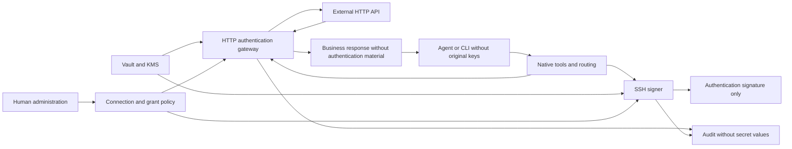

# ZeroPW authentication relay and security boundaries

Written 2026-09-12. Design requirements; implementation and deployment evidence are recorded separately.

## 1. Boundary to protect

Agents, CLIs, agent-written code, working files and tool responses must not receive original secrets. The vault, authentication gateway and signer that hold those secrets belong to a separate trust domain. The gateway must not execute agent-submitted code.

Cloud execution must separate identity, file and process access, networking and administrative authority. Splitting two processes on the same host while sharing debugging, volumes or administration does not count as isolation. Protect secrets with KMS-backed encryption and least privilege, and authenticate communication between trusted services.

An agent's restricted usage capability is different from a vault credential. Agents can exercise or leak their allowed authority, so capabilities need short expiry, destination and action restrictions, usage limits, revocation and audit. Withholding original secrets does not prevent compromise of trusted services or harm from already-authorized actions.

## 2. Authentication paths

The HTTP gateway checks connection policy and adds authentication only to requests sent to permitted destinations. It removes or blocks authentication material in responses before returning business results. It never returns the original key to the CLI.

For SSH, the client communicates with the server and the signer provides authentication signatures. The signer does not execute remote commands. Bind signatures to validated SSH authentication requests and destinations; do not reuse the key for arbitrary bytes or other signing purposes.

## 3. Connections and native tools

Tool names may change during implementation, but these contracts remain:

| Tool | Inputs and results |
| --- | --- |
| `list_connections` | Return only this caller's usable connection IDs, descriptions, supported protocols and permissions. Do not expose values or another user's connections. |
| `exec` | Receive a connection and arguments; run its supported CLI in a secret-free execution environment with authentication delegation and routing. Return business output and execution state. |
| `request` | Receive a connection ID, HTTP method, relative path and request data. Authenticate only to the permitted destination and return business responses. |
| `status` / `cancel` | Inspect or cancel an execution owned by the caller. Never return secrets or authentication headers. |

No agent tool provides secret retrieval or export. Every call verifies identity and connection ownership. `exec` must not run user code inside the trusted gateway; `request` must not send credentials to arbitrary hosts.

Tokens and handles given to the execution environment are separate from original keys and restricted by caller identity, connection, destination, duration and usage count. Unsupported CLI authentication must return an explicit unsupported error. Never fall back to putting secrets in environments, files, arguments or credential-helper results.

## 4. Protocol controls and compatibility

| Path | Required controls |
| --- | --- |
| HTTP routing | Validate destination host, port and TLS identity. Block arbitrary hosts, open CONNECT, redirects and DNS changes that enable internal/metadata access or credential forwarding. |
| HTTP authentication | Insert credentials only into outbound requests. A caller must not manipulate headers or connection selection to read or use another secret. |
| HTTP responses | Return useful business data. Restrict reflection, credential-query/issuance endpoints, debug routes and authentication-bearing errors or streams according to the service's behavior. |
| SSH authentication | Validate agent-protocol integration and session/destination binding. Unsupported clients fail explicitly. Do not export keys, provide general signing or allow forwarding by default. |
| Logs, traces and temporary files | Never record request authentication or vault values, including debugging, crash reports, proxy traces and error logs. |

A HTTPS CONNECT tunnel alone cannot change authentication headers inside an encrypted request. Validate a relay-compatible base URL, safe TLS termination or the CLI's official delegation mechanism. Certificate pinning and mandatory local plaintext credentials can make a CLI unsupported.

Service profiles define authentication, destinations, credential-exposing endpoints, response handling and compatible clients. Integration code is the product's responsibility, not a catalog of commands the user must register. Different allowed requests reuse the same connection.

String masking alone cannot guarantee protection against transformed or encoded leakage. Inspect service reflection behavior beforehand and explicitly list the safely supported scope. Do not release an integration whose supported paths can expose authentication material. Instructions inside external responses are data, not authority to change policy.

## 5. Grants, approval and revocation

Deny by default. Bind grants to caller, project/environment, connection, destination, permitted actions, expiry and usage. Users configure a connection's scope rather than registering or approving each command. Destructive actions such as deletion or payment may require additional confirmation.

Bind usage capabilities to connection, credential version, destination and policy version. Reevaluate them after changes; never automatically inherit broader authority. Check current revocation and expiry immediately before each request and signature. When an individual request needs approval, bind its input digest to the server-interpreted destination and action so input cannot change afterward.

Integration release approval is separate from a user's connection grant. Binding reviewed code to an artifact digest must not force per-command registration or reapproval after compatible updates.

Immediate revocation means rejecting new relay/signing requests and cancelling queued executions once revocation state is applied. Cancel in-flight work where possible. It does not undo external operations or automatically terminate authenticated SSH sessions; server-side controls are needed for that. Provide a global stop and abnormal-use alerts.

Associate caller and request ID with an input digest to distinguish duplicates. If a write outcome is uncertain, inspect status instead of retrying blindly. Do not promise exactly-once execution for every external service.

## 6. Secret and operational authority lifecycle

Separate human administrative authentication from agent identity. Do not expose secret input/reveal screens to agent-controlled browser sessions. CORS is not authorization. Any environment-file import must parse data, never execute it.

A human's single-secret reveal requires reauthentication and audit. Do not initially provide bulk plaintext export. Manage recovery material independently; revoke existing sessions and grants during recovery. Do not promise recovery after all recovery and decryption authority is lost.

Rotation registers a new version, verifies authentication, switches connections and revokes the old credential at the provider. Deleting a vault value does not revoke a provider key. After restoring an encrypted backup, block execution until current revocation state has been applied.

Audit caller, connection, destination, action, result and policy version without secret values or authentication headers. Agents must not directly read, edit or delete audit storage. Gateways/signers receive only required append authority; human reading uses separate authorization. Failure to write mandatory audit must also deny authentication.

Agents and development workers must not acquire KMS/vault administration, policy administration, deployment, audit, recovery or backup authority. Never put ZeroPW's own bootstrap privileges or model API keys into business connections.

## 7. Acceptance tests

| Behavior | Pass condition |
| --- | --- |
| Different operations after one connection setup | Different CLI/API operations succeed without individual registration. |
| Original-key extraction | Environment, files, debugging and other-process access do not expose original values. |
| Response/error/log leakage | Reflection, redirects, transformations/encoding, streams and traces do not expose authentication material. |
| Connection/destination substitution | ID replacement, target manipulation, forged SSH destinations and session reuse cannot bypass policy. |
| SSH key misuse | Export, arbitrary signing and unauthorized forwarding are rejected. |
| Unsupported CLI | Explicit unsupported error with no raw-key injection fallback. |
| Expiry, revocation and global stop | Reject new authentication and cancel queued work; describe existing-session limits in UI and tests. |
| Operational/recovery bypass | Worker authority cannot access management/KMS/backup/audit/harness keys or use restore to reverse revocation. |

Use synthetic credentials and controlled servers to test both successful operations and attacks. These are requirements, not a claim that current code or deployment has passed every security gate.
